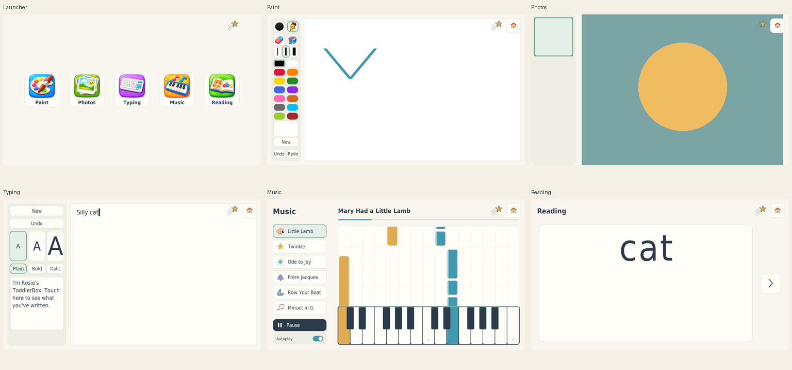
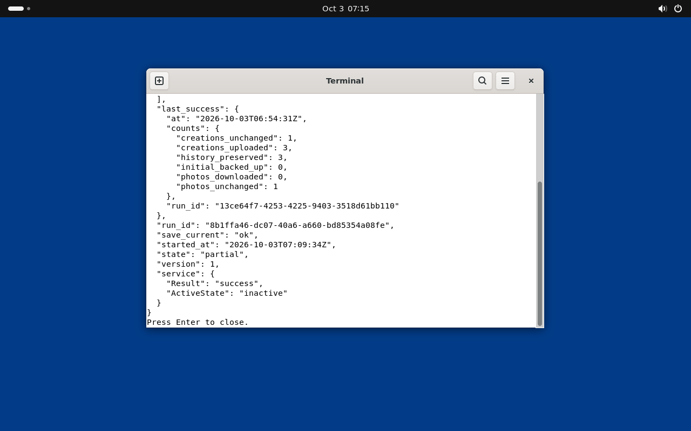

> Evidence is chronological. The latest section records the pending 0.5.2 update-only candidate; it is not a publication or physical-hardware acceptance claim. Earlier installer IDs, passes and pending items belong to their recorded checkpoints. Previously qualified artifacts remain preserved.

## Pending audio patch — 2026-10-09

Issues #11 and #12 are implemented on `codex/audio-polish`, based on actual
main `30edbfad89187e07b480418c328d6536593540c6`. This is application/system-source
qualification only: no merge, signed update or installer build. The later USB
setup extension below bumps the unreleased source version to 0.5.0.
Published 0.4.0 and its qualified VM checkpoints remain unchanged.

Toolchain: Linux x86-64; uv 0.12.19, CPython 3.12.14, pygame-ce 2.5.8 / SDL
2.32.10, Pillow 12.3.0, pytest 9.1.1 and PyYAML 6.0.3; frozen project dependencies.
The unchanged baseline passed 451 tests. Audio-only commit `ae90090` passed
477 tests; the later USB extension below passes 506.
An AF_UNIX socket test initially failed under the restrictive command sandbox;
the identical test failed on the real unmodified baseline in that sandbox.
The complete suite passes with the tool's network permission, including real
Linux credential authentication; no production guard or test was weakened.

Intended differences: song gain 0.25→1.0; Reading/Math gain 0.35→0.70;
child-session startup master 0.80 with a bounded sink wait and unity ceiling;
manual keys share a 0.70 gain budget and use a 600 ms quadratic release envelope.
Existing custom gains are untouched unless the authenticated parent explicitly
applies new audio defaults. That action durably retains the original root-owned
configuration, preserves other settings and refuses child mode, malformed
sections, symlink/hardlink paths and arbitrary destination arguments.

Repeatable checks (baseline is a genuine `git archive`, never a reconstructed
implementation):

```sh
mkdir -p build/audio-polish/baseline-source
git archive 30edbfad89187e07b480418c328d6536593540c6 | tar -x -C build/audio-polish/baseline-source
UV_CACHE_DIR=/tmp/uv-cache uv run --frozen pytest -q
UV_CACHE_DIR=/tmp/uv-cache uv run --frozen python scripts/check-audio-polish.py --baseline build/audio-polish/baseline-source --output build/audio-polish/pcm-final
UV_CACHE_DIR=/tmp/uv-cache uv run --frozen python scripts/check-sync-rendering.py --render build/audio-polish/baseline-source --output build/audio-polish/render-old --state baseline
UV_CACHE_DIR=/tmp/uv-cache uv run --frozen python scripts/check-sync-rendering.py --render . --output build/audio-polish/render-new --state baseline
bash -n system/bin/toddlerbox-session
sh -n system/bin/toddlerbox-volume
git diff --check
```

Actual SDL disk-driver PCM peaks: song 5000→20000 (**4.0×**), speech
6875→13906 (**2.02269×**, SDL gain quantization). The same real C4 sample rings
for approximately 128 ms after release on baseline versus 580 ms on candidate,
including disk-buffer timing. Synthetic song plus sixteen rapid overlapping
real piano strikes peaks at 25604/32768 with **zero saturated samples** and
maximum aggregate key gain 0.6875. All eighteen pinned songs and twenty-five
key samples retain their bytes and satisfy the independent peak-headroom check.

Independent Sol review found SDL's native fade-out could overwrite a channel
budget on later mixer ticks. The final implementation replaces that mechanism
with the event-loop envelope and reserves gain before starting a new note.
Review confirmed the repair; 95 expanded focused tests passed with no further
material findings. Regression checks cover mouse/raw-finger release, glissando,
repeated notes, overlapping tails, eight held voices, oldest-tail replacement,
natural completion, immediate cleanup, startup stalls and explicit parent opt-in.
Controller escape/watchdog and save/IPC implementations are unchanged.

Before/after rendering: all **20** existing render/save/decoder artifacts
(six screens at two sizes, plus saved outputs) match byte-for-byte. Math's
existing `scripts/check-math-followup.py` RUNNER was run with version `new` on
both actual sources; all **40** PNGs match byte-for-byte, without masking any
pixels. No child UI controls or media assets changed.

Startup scale was checked against upstream WirePlumber **0.4.17** `wpctl.c`
and `module-mixer-api.c`: wpctl selects cubic scale; 0.80 maps to 0.512 linear
gain before hardware calibration. This is not physical-speaker evidence.
Actual Ubuntu/PipeWire session startup, HP loudness/headphones, and the parent's
choice of startup level remain for later installer qualification and listening.

## Pending 0.5.0 USB setup extension — 2026-10-09

Issue #13 extends PR #14 on `codex/audio-polish`, with actual audio-only baseline
`ae900905da1447da293e11a0f945eee0e65bab97`. Source and uv lock metadata
now specify **0.5.0**. No new installer, signed bundle, tag or release is published.
The baseline desktop CLI required a package path and independent checksum;
parent maintenance required a path and calculated its own checksum. Neither
provided the accepted mounted-USB/adjacent-checksum selection flow.

The new explicit flow discovers removable/USB mounts using Ubuntu lsblk, scans
only their roots, displays volume/name/bytes, selects a sole candidate or asks
for a numbered selection, and verifies exactly one adjacent checksum. A checksum
cannot supply a path. This is transfer integrity under authenticated physical
USB trust, not origin authentication. A stable private copy feeds the unchanged
conservative importer. USB sources remain intact. A parent-mode recheck under
the shared maintenance lock prevents a concurrent child transition at install.
Successful receipts record full SHA-256 and accurate new-photo counts, and are
shown separately from sync status. Results remain visible until dismissed.

Commands:

```sh
UV_CACHE_DIR=/tmp/uv-cache uv lock
UV_CACHE_DIR=/tmp/uv-cache uv run --frozen pytest -q
UV_CACHE_DIR=/tmp/uv-cache uv run --frozen pytest -q tests/test_usb_setup.py tests/test_drive_sync.py tests/test_appliance.py
sh -n scripts/install-drive-setup-patch.sh
git diff --check
```

**506 tests passed** (same frozen toolchain as the audio checkpoint; dependency
versions unchanged). Synthetic regressions cover both naming conventions,
multiple selection/cancel, malformed/ambiguous/mismatched/missing/incorrect
checksums, symlink/hardlink refusal, source replacement/mutation, USB removal,
disk reserve failure, stable import inputs, repeat/newer-work preservation,
receipt accuracy, visible sanitized failure and final parent lock/guard ordering.
Existing interrupted-import/no-overwrite tests also pass. Sol review identified
three gaps (unavailable audio menu on a USB-only patch, missing setup status,
and late parent-mode check); all were repaired. Final independent USB/Drive
checks: **69 passed**, no further material findings.

Actual Ubuntu 24.04 removable-media qualification used a **disposable qcow2
VM overlay**, backing the preserved `build/appliance-qualified/disk.qcow2`,
QEMU TCG/q35/qemu64, two CPUs, 2 GiB RAM and **no network**. A synthetic 16 MiB
ext4 disk was attached as QEMU `usb-storage`, mounted at a synthetic `/media`
path, and discovered by the guest's real lsblk. The guest installed the public
source-checkout patch, then executed the production CLI with confirmation:
first setup imported one synthetic PNG, repeat setup imported zero and reported
already-installed, the full SHA receipt matched and appeared in status, and
both USB transfer files remained. Invalid checksum and child-mode setup returned
failure with visible messages. A second patch application and repeated setup
also passed. Existing synthetic Paint/Typing files also passed their original SHA-256
checks after setup. Guest kernel: 6.8.0-142-generic, Python 3.12.3 and util-linux
lsblk 2.39.3; preserved base content ID `8776dfa5476b7156`. Actual output is
shown below.


The VM used a direct-kernel privileged test console, not a fresh install or
GNOME/polkit interaction test. Host code tested the same root guards; physical
USB mounting, parent authentication UX and HP acceptance remain unverified.
Only synthetic fixtures were used. The new overlay and logs are under
`build/audio-polish/usb-vm/`; prior disks/checkpoints were not modified. An initial
diagnostic used an older pre-appliance image and was replaced by a new overlay
of the proper qualified appliance base before the successful run.

Existing-install application is deliberately small and offline:
`sudo sh scripts/install-drive-setup-patch.sh`, then
`sudo toddlerbox-sync setup`. It durably backs up and replaces only the USB
module, CLI and maintenance program, under parent mode and maintenance lock.
It does not reset setup progress/data/credentials/device identity or replace the
resident recovery gate/signed updater. Audio choices remain hidden on old app
versions. This explicit trusted-checkout patch is not a signed release; future
release packaging/installer qualification remains separate work.

## Pending 0.5.0 DNS repair — 2026-10-10

Actual before-change source: `e3bc57aaa4ffd97bfc69fe591d9b361e31265e8b`.
The parent reported connected HP Wi-Fi, with DHCP gateway/DNS 192.168.0.1,
while `/etc/resolv.conf` selected the unworking local stub 127.0.0.53.
The parent confirmed Internet resolution works after the explicit NetworkManager
policy `dns=default`, `rc-manager=file` and a NetworkManager restart.

The image and existing-install parent patch now deploy the identical shared
`system/90-toddlerbox-dns.conf`. The existing resolver symlink remains pointed at
NetworkManager's generated file. DNS comes from connection settings/DHCP; no
router or public IP is embedded. The guarded patch backs up any prior policy
and writes it atomically, without automatically restarting networking. Apply
on next boot, or explicitly restart NetworkManager in parent mode.

**507 tests passed** with the frozen toolchain above; `test_dns_policy.py`
executes the actual image installation line in a temporary root, verifies its
bytes/permissions and the patch's shared destination. `bash -n` / `sh -n` and
`git diff --check` pass. Independent Sol review found no material issues.

The preserved disposable Ubuntu VM overlay ran the actual NetworkManager
binary, whose vendor `10-dns-resolved.conf` supplies the old implicit stub policy.
Before/after `NetworkManager --print-config` and an activated synthetic dummy
connection show the override selects `dns=default`, `rc-manager=file` and writes
connection-supplied `nameserver 192.0.2.53` into `/etc/resolv.conf`, without the
127.0.0.53 stub. After a real guest reboot, without reapplying the patch,
NetworkManager again selected the same policy and generated the same
connection-provided DNS; `DNS_REBOOT_VM_PASS` is recorded in
`dns-after-reboot.txt`. The test-only dummy needed a `/run` unmanaged-device override;
that file is not in the public patch/image. This synthetic reserved IP is not an
Internet DNS server. Logs are in `build/audio-polish/usb-vm/dns-*.txt`/`.conf`.
No real cloud credentials or family data were used, no prior VM base was changed,
and no installer or release was built. Physical HP resolution is parent-reported;
builder evidence verifies resolver ownership/generation, not real Internet access.

# Bootable system validation — 2026-10-02

The [Reading qualification](#reading-application-qualification) below records
the historical release **`c12b9037f41f5f85`**. Earlier sections retain the
shared interface, Music/repair and initial system results as historical evidence.

This is a development baseline for VM iteration. Hardware, extended operation,
and the remaining failure cases below still require qualification before using
it as the child's everyday system.

## Environment and evidence

The builder is x86-64 Linux with Docker's vfs storage driver. There is no KVM
device or physical graphics/touch hardware available. Guests use QEMU TCG,
`qemu64`, OVMF UEFI, two virtual CPUs, 4 GiB RAM, virtio graphics/disk, a USB
tablet, and no network. Screenshots and keyboard input use local QMP; a separate
serial login provides diagnostics even when the graphical application is frozen.

In this managed workspace, Docker commands used the local socket explicitly:

```bash
export DOCKER_HOST=unix:///var/run/docker.sock
export BUILDX_CONFIG=/workspace/.cache/buildx UV_CACHE_DIR=/workspace/.cache/uv
unset DOCKER_CONTEXT DOCKER_TLS DOCKER_TLS_VERIFY DOCKER_CERT_PATH
```

The inherited Docker proxy configuration was retained. No network access is
needed by a running guest or by the finished installer.

QEMU's `max` CPU caused GNOME's software renderer to crash on AVX2 instructions
under TCG. The `qemu64` configuration passed the desktop checks. This is a VM
configuration finding, not a diagnosis of the HP laptop.

## Completed checks

The initial integrated qualification used release `88ac086773976b6a`:

| Check | Observed result |
| --- | --- |
| Fresh image boot | First boot required creation of the parent password; no default password |
| Standalone child session | GDM started Cage on a Wayland seat; no child GNOME shell; fullscreen launcher visible |
| Parent recovery with a frozen app | After SIGSTOP, holding Ctrl+Alt+Home switched to parent login and terminated the stopped app |
| Parent desktop | Password authentication reached Ubuntu GNOME; no repeated renderer crashes with `qemu64` |
| Return to child | Administrative child-mode command restored the launcher and healthy frames |
| Saved work | Typing autosaved `savedwork`; the document restored after forced termination, reboot, and return to child mode |
| Repeated hangs | Four successive SIGSTOP injections produced exactly three restarts, then a persistent parent recovery latch |
| Recovery reboot | Parent mode persisted across reboot |
| App release switching | Installed a second bundle, retained the previous release, rolled back to `88ac086773976b6a`; saved typing remained unchanged |
| Rollback without a previous release | Refused with a nonzero command result |
| Installer cancellation | Incorrect erase confirmation left the blank VM target untouched |
| USB installer path | Booted ISO, verified payload checksum, wrote 12 GiB disk, expanded root to the 16 GiB target, powered off |
| Installed disk | Booted without ISO, required parent setup, entered healthy child mode, then reached GNOME parent login |

The installer test exposed BusyBox replacing the standard `dd` path during
initramfs generation. The recipe now bundles GNU dd at a dedicated path; the
successful installation used that correction. The final release also narrows
shutdown signals to the Python application, preserving its opportunity to save
before the compositor is stopped. Build assembly releases its temporary export
container before constructing disks to reduce peak storage use.

Local evidence is retained under ignored `build/`: `vm/fault-result.log`,
`vm/rollback-result.log`, `vm/qualified-restored-typing.png`,
`vm/qualified-parent-desktop.png`, `install-vm/install-result.log`,
`install-vm/installed-result.log`, and `install-vm/installed-parent.png`.
VM password files are disposable local test credentials and are not in images
or tracked source.

## Automated checks

`uv run --offline pytest -q`: **65 passed**. Coverage includes interrupted
writes, failed fsync, simulated ENOSPC, preserving previous saves and in-memory
work, current-document restoration, corrupt-save preservation, legacy typing
archives, startup retry exhaustion, and the independent escape chord.

Shell syntax, systemd unit verification, and `git diff --check` passed. Image
assembly compares the raw and QCOW2 disks byte-for-byte with `qemu-img compare`
and generates artifact SHA-256 checksums.

## Final build artifacts

The completed build produced release **`f903c7e5135a9dc9`**, using Ubuntu 24.04
and kernel `6.8.0-142-generic`. `build/final-build.log` records the successful
build and raw/QCOW2 comparison. All three checksums were independently rechecked
with `sha256sum -c SHA256SUMS`:

```text
a1e0006f2beff01d3b2e4d60be2b64a94fc03fda7b41fc9e6d0476821e208e8e  toddlerbox.img
64764ea45c933eb711f79fb16ba01c8b2d9f5770cd8b6a54b6191d6bea82180c  toddlerbox.qcow2
c6f088371851de553761b42c0bf6f3d9b5c0a58417b40d1e3dcc120f10133ee8  toddlerbox-installer.iso
```

The host VM helper subsequently gained separate UEFI variable files for baseline
and installation disks. Reusing the baseline firmware state had selected the
UEFI shell instead of the installer. Fresh firmware booted the final ISO. This
helper-only change does not modify the system image or its release identity.

The final ISO was then installed to another fresh 16 GiB VM disk. Payload
verification, disk writing, filesystem expansion, shutdown, first boot, and
parent password creation passed. The installed release reported
`f903c7e5135a9dc9`, a 16 GiB root filesystem, healthy child frames, and zero
retries. Paint drew and restored a stroke after returning Home; Photos opened
its empty-library view; Typing saved `finalwork`. Evidence is in
`build/vm/final-install-result.log`, `final-installed-result.log`,
`final-launcher.png`, `final-paint-restored.png`, `final-photos.png`, and
`final-typing.png`.

On the final release, entering parent mode saved the newly added `z` in
`finalworkz`; returning to child mode produced healthy frames. SIGSTOP followed
by the two-second parent chord removed the frozen Python process and reached
the GNOME parent login. The first GNOME greeter took roughly a minute to become
usable under TCG; this is not a hardware recovery-time measurement.
Parent password authentication then reached the ordinary GNOME desktop on the
final release (`final-parent-desktop.png`), with an active parent seat session
and no kernel-reported segfaults during this boot.
Selecting **Start ToddlerBox** from GNOME search and authenticating through
polkit returned to the fullscreen child launcher, with healthy frames and zero
retries (`final-returned-child.png`). The final installed test disk is retained
at `build/vm/install-target.qcow2`; the VM was shut down after validation.

## Remaining qualification

- Physical USB boot/install, HP graphics and touchscreen edges/multiple fingers,
  keyboard/trackpad mapping, cold boots, and parent sleep/resume.
- Secure Boot: the initial installer is unsigned; qualification requires it disabled.
  The installed system requires x86-64 UEFI, even though the installer also boots BIOS.
- Extended soak with memory, process, log, and save measurements.
- Whole-guest disk exhaustion and abrupt virtual power cuts during saves; simulated
  write failures are covered, but they do not establish physical storage behavior.
- Deliberately broken startup in the VM, beyond the unit coverage of retry
  policy; explicit GRUB parent-recovery selection. Controller KILL/SIGSTOP
  recovery was subsequently qualified below.
- Installation refusal cases beyond cancellation: undersized targets, mounted
  filesystems, installer-media targets, and damaged payloads.

The existing HP session and the cause of its previous instability remain unknown.

## Music and repair qualification

The integrated implementation is committed in `fbee06e` (Astra repairs) and
`b28d7eb` (Music and integration). The final build is release
**`e65218acd46d664e`**, produced by `./system/build.sh` from the shared Ubuntu
24.04 recipe. `build/music-final-build.log` records the build and successful
raw/QCOW2 comparison. The release ID matches `system/source-id.py`; generated
Python package metadata is excluded from that identity.

### Automated and asset checks

- `UV_CACHE_DIR=/workspace/.cache/uv uv run --offline pytest -q`:
  **178 passed**. This includes pointer ownership/duplicate suppression,
  drawing/save regressions, bounded caches and archives, preservation on storage
  errors, release compatibility, and Music playback/state/cleanup behavior.
- Shell syntax and `git diff --check` passed. Controller credential/pidfd tests
  use simulated boundaries where the workspace sandbox blocks kernel operations;
  the real guest controller checks below complement them.
- Regenerating all 14 Music outputs offline produced byte-identical files.
  Preparing the piano inputs again from the cached, pinned upstream samples also
  reproduced the committed inputs. Six decoded tracks contain audio without
  clipping, have initial onsets within 50 ms of their first cues, and end quietly.
  These are asset measurements, not physical speaker latency or human listening.
- Launcher and Music screenshots were inspected at 1024×600 and 1366×768.
  The committed [Music screenshot](assets/screenshots/music.png) illustrates the
  passive keyboard visualization. Source, arrangement, instrument and recording
  provenance is recorded in [the asset documentation](assets/music/README.md).

### Actual guest checks

Recovery fault injection used release `53cf9f20f23af22c`. Its application,
controller and bundled Music code/assets match the final release; subsequent
changes corrected the host's fresh-overlay UEFI state and source identity
calculation. The final release was separately installed and exercised below.
Guests used x86-64 TCG, a standalone Cage Wayland child session, PipeWire and
emulated Intel HDA, with QEMU recording audio to a WAV file.

| Check | Observed result |
| --- | --- |
| Child session | Fullscreen four-activity launcher, healthy frames, zero retries, no child GNOME shell |
| Music output | Nonzero captured PCM; selection, automatic track advancement and resumed playback produced output |
| Controller SIGKILL during Music | Systemd restarted the controller in persistent parent mode; old child exited and audio capture stopped advancing; GDM was active |
| Controller SIGSTOP | The 10-second systemd watchdog aborted the stopped controller; restart reached persistent parent mode, removed the old child and activated GDM |
| Parent authentication | Password login reached the ordinary GNOME desktop after recovery |
| Recovery reboot | Parent recovery latch survived reboot; the greeter remained available |
| Independent parent chord | With the launcher deliberately stopped, holding Ctrl+Alt+Home for 2.5 seconds entered parent mode and removed the frozen process |
| Final ISO installation | Booted the final ISO on a fresh 16 GiB target, verified its payload, wrote the disk, expanded ext4 and powered off |
| Installed final disk | Booted without the ISO, completed parent password setup and entered healthy child mode; release ID and all six bundled WAV hashes matched |
| Installed Music | Played from the installed disk and advanced automatically through the song list to Minuet |
| Installed pause/resume | Paused note-field screenshots matched exactly and captured PCM was zero; playback resumed afterward |
| Installed Home cleanup | Returning Home from Music produced zero captured PCM |
| Installed Paint | A single-click dot remained after Home and re-entry |
| Installed Photos | Opened the empty-library view |
| Installed Typing | `musicready` restored after Home and re-entry; the added `z` was present in `current.json` after parent transition, yielding `musicreadyz` |

The final installed root filesystem reported 16 GiB with approximately 13 GiB
available. Local logs/screenshots are retained under ignored `build/vm/`:
`music-controller-kill.log`, `music-controller-stop-verified.log`,
`music-reboot-parent-status.log`, `music-app-chord-recovery.log`,
`music-parent-desktop.png`, `music-final-installer.log`,
`music-installed-status.log`, `music-installed-playing.png`,
`music-installed-pause-a.png`, `music-installed-pause-b.png`,
`music-installed-home.png`, `music-installed-paint-restored.png`,
`music-installed-photos.png`, `music-installed-typing-restored.png`, and
`music-installed-parent-save.log`. Disposable VM credentials remain local and
are excluded from source and installation media.

### Final artifact checksums

All system and application bundle checksums were independently verified:

```text
eb73f17803f7702633a734ab14961d234b5ca0c3f199923515f95bab9dfce6f3  toddlerbox.img
b85540b157d15423cfe22095e3a3e732a3718d2190547ea987a181104e82dc2e  toddlerbox.qcow2
7b01f930389c8eadf41fb1d5dcd388b798f90d6bd9d82c6cd29e75b9ab09640c  toddlerbox-installer.iso
48652ba0e32c9ea40396eff4b51b9bad5b9e77195041302ce635c723dc5e9ca7  toddlerbox-app-e65218acd46d664e.tar.gz
```

### Limits of this qualification

Physical HP touch routing and edge gestures, graphics, keyboard/trackpad,
speaker volume and audiovisual timing, USB installation, and sleep/resume still
need hardware qualification. Human listening to the arrangements and a
multi-hour representative-content soak are also outstanding. The existing
whole-guest ENOSPC, abrupt power-cut, interrupted release-switch, startup and
installer-refusal gates remain open; simulated storage failure tests do not
establish durability on the HP. The Music changes do not require a network at
runtime, and no claim of physical hardware validation is made.

## Shared interface qualification

The shared theme is implemented in `17bda97` and `9d75b46`. All four activities
use the same background, card, typography and selection colors, with a common
58px Home control. The original app/tool/Home artwork is retained; Music adds
a matching illustrated launcher icon. Document geometry, Paint pixels and
persistence/recovery algorithms are unchanged.

- **178 tests passed** after the final icon changes.
- Screenshots were inspected at 1024×600 and 1366×768, including empty and
  populated Photos, and the [combined preview](assets/screenshots/overview.png).
- Release **`6bf84a8245b3f9b6`** uses the existing pinned Ubuntu base and image
  tools with the current `Dockerfile.release` and `make-images.sh` recipe.
  `build/style-final-build.log` records successful assembly, filesystem checks
  and identical raw/QCOW2 contents. The source identity matches the checkout.
- All four artifact hashes were independently verified. The new ISO contains
  the same assembled system payload as the VM disk. The ISO's erase/write/expand
  installation path was qualified in the preceding Music release; this visual
  update does not change that path.

The final disk booted in a fresh x86-64 UEFI/TCG overlay, completed parent
password setup, and entered a healthy standalone Cage child session with zero
retries. All four activities were opened through the illustrated launcher;
their common Home control returned to the launcher. Paint's single-tap dot and
Typing's `style` text restored after Home and re-entry. Music produced nonzero
captured PCM during playback (peak 3751) and zero PCM after Home. A parent-mode
transition then preserved `style` in the current Typing document and stopped
the child cleanly. Evidence is under `build/vm/`: `style-guest-status.log`,
`style-smoke.log`, `style-overview.png`, and the individual `style-*.png` captures.

```text
11f134be07e7117ad7c9b08aa24772b9f3fe76c1c3b82da73a9cb1d30cbbbe78  toddlerbox.img
1881810c49f7fa7744884d75d120ba0bef294fcab71e2685e76b7316d0e8f8e8  toddlerbox.qcow2
5b9a8675936a9d3df886a923bcd909eeddccbb9c681b7b99df680030204c38aa  toddlerbox-installer.iso
e1f4d7853b7538a25b7a77a0639328edc211e79d05913d109c4dc51e1c7db725  toddlerbox-app-6bf84a8245b3f9b6.tar.gz
```

### Bounded extra storage check

Astra independently used a disposable overlay over the qualified `e65218acd46d664e`
installed disk; the base disk was mounted read-only and its modification time
remained unchanged. Installed application save methods targeted a 32 MiB ext4
loop filesystem inside that guest. Filler writes reached actual ENOSPC.
Typing's attempted save returned failure, and subsequent independent read-only
inspection found the valid previously committed text `prior`, preserving it
against the attempted `priornew` replacement.

This is one actual guest data-filesystem save-failure observation. Paint's tiny
PNG still fit in the remaining space, so its expected-failure assertion did not
pass and the rest of that test was not reached. Whole-root exhaustion, controlled
power cuts, and Paint preservation under actual ENOSPC remain open. Host build
storage exhaustion also occurred during follow-up; the agent stopped new fault
writes and kept later inspection read-only. That host event is not a guest
storage-test success. Evidence and limitations are retained in ignored
`build/storage-qa/RESULTS.txt`, `serial.log` and `enospc.sh`.

The installer build was completed after reclaiming disposable build staging,
unused intermediate Docker images and build cache. Qualified VM disks were
preserved. Physical HP, listening, extended-operation and other previously
listed qualification limits remain unchanged.

## Reading application qualification

Reading adds 30 illustrated words, alphabet sound/name decks, and numbers 0–30.
The shared launcher now fits five icons in centered rows where required.

- **201 tests passed** in 4.14 seconds: 178 existing tests plus 23 Reading checks.
- All **158 source assets and 189 prepared outputs** passed SHA-256 verification.
  A separate rebuild reproduced every prepared file and catalog byte-for-byte.
  Independently regenerating all 31 number WAVs with the locked Piper preparation
  environment reproduced their hashes exactly.
- Screens were inspected at 800×600, 1024×600, 1280×800 and 1366×768, including
  the word-first, sound-highlight and picture states, letters, numbers and the
  five-icon launcher. Automated layout coverage also includes 1024×768.
- A bounded dummy-SDL run made **1,000 random selections** after 100 warm-up
  selections with no immediate repeats. RSS increased from 32,984 to 34,428 KiB;
  the maximum selection-plus-render time was 9.245ms. This is a short local
  allocation/responsiveness check, not a multi-hour hardware soak.
- Source/derived media licenses and the differing recorded voices are documented
  in [assets/reading/README.md](assets/reading/README.md). Original media and
  editable drawings are included. Human listening/pronunciation review remains
  outstanding; decoding and waveform bounds do not establish pedagogical quality.

### Built system and actual guest checks

Release **`c12b9037f41f5f85`** was built with `./system/build.sh` from the shared
Ubuntu 24.04 recipe. Filesystem checking, raw/QCOW2 comparison and independent
verification of all four artifact checksums passed. The source identity matches
the application/configuration used for these checks.

The fresh x86-64 UEFI/TCG overlay required parent password creation, then opened
the five-activity launcher in standalone Cage. The controller reported healthy
frames, zero retries and no child GNOME shell.

| Check | Observed result |
| --- | --- |
| Word-first interaction | The initial card had no picture; tapping played the sequence and revealed the illustration |
| Captured speech | Nonzero PCM, peak 7276; this verifies output, not pronunciation or physical loudness |
| Next and Home | Next changed the word; both controls interrupted speech and subsequent captured PCM was zero |
| Shared audio | Music → Reading → Music worked in the shared process |
| Other activities | Paint's dot and Typing's `reading` restored after Home/re-entry; Photos opened |
| Parent-selected decks | Lowercase sounds, uppercase letter names, and number 23 played and revealed their illustration/quantity |
| Actual data ENOSPC plus damaged media | A dedicated 16 MiB ext4 loop filesystem reached zero available bytes; a 4096-byte write failed ENOSPC. With this as Reading's data root and a corrupt `cat` sequence, remaining cards still played/revealed, Next/Home worked, and the controller retained zero retries |
| Independent frozen-app escape | After SIGSTOP during Reading, the held parent chord removed the stopped launcher, persisted the parent latch, reached GNOME login and left zero captured PCM |

The recovery harness's first fixed 12-second host wait was too short under TCG.
Subsequent independent serial checks confirmed parent mode, absence of the stopped
PID, and the controller's exact reason: `Ctrl+Alt+Home held for two seconds`.
This is not a physical recovery-time measurement. The storage fixture was removed,
the original configuration restored, and the original recording hash rechecked.
This bounded Reading test does not qualify whole-root exhaustion or Paint saves.

The final ISO then installed onto a separate blank 16 GiB virtual disk. Payload
verification, disk writing, filesystem checking/expansion and shutdown passed.
Without the ISO attached, that disk required parent password setup and reached
healthy child mode with zero retries. Its root filesystem reported 16 GiB with
13 GiB available; all 189 Reading output hashes matched. Reading played speech
(captured PCM peak 7284), revealed its picture, and stopped cleanly on Home
(zero PCM). Typing saved `reading`, and an administrative transition entered
persistent parent mode.
Password authentication started an active parent seat session with `gnome-shell`;
an administrative return to child mode restored the fullscreen launcher, healthy
frames and zero retries. The saved Typing text remained `reading`. Parent session
authentication/process state was verified over serial; the desktop's finished
render was not separately captured in this Reading pass.

Local evidence includes `build/reading-final-build.log`, `build/reading-preview/`,
`build/reading-rebuild/`, `build/reading-number-check/`,
`build/reading-selection-check.json`, and `build/vm/reading-{guest-status,smoke,decks,storage-fault,recovery-verified}.log`.
Screenshots and captured audio are retained under ignored `build/vm/`.
Installer evidence is in `build/vm/reading-installer.log`,
`reading-installed-status.log`, `reading-installed-smoke.log`, and
`reading-installed-results.json`, plus `reading-installed-parent-status.log` and
`reading-installed-return-child.log`; the installed disk is retained at
`build/reading-install/disk.qcow2`. Earlier qualified disks were preserved.

### Artifact checksums

```text
6f34008d9526e3a9a72cf66ef6d2b962071698f498d40d66d661f34cf02a7b23  toddlerbox.img
5eff20ed23636c84f7f1edebb93486d255eafa1afde36980090559d6f81cb4a9  toddlerbox.qcow2
059af6824818796db59aa35d4ad0ca086e788e81e1a94782c579ac41cb86ecb4  toddlerbox-installer.iso
f2b66b58b8be1c994937c9c9c27f5e7850ac1d0ac0d5e0aa666ac1a9f7e9b3c8  toddlerbox-app-c12b9037f41f5f85.tar.gz
```

HP touchscreen/graphics/speakers, USB boot on physical hardware, sleep/resume,
human listening and multi-hour operation remain unqualified. Earlier open
whole-root/power-cut/startup/installer-refusal gates also remain open.

## Preparing a USB after qualification

Check `build/SHA256SUMS`. In Ubuntu Disks, select the intended USB device and use
**Restore Disk Image** with `build/toddlerbox-installer.iso`; this replaces the
USB's contents. Boot it on the backed-up target computer in UEFI mode. The
installer separately identifies the internal target disk and requires an exact
erase phrase before replacing that disk. On first boot, set the parent password.
Preserve `/var/lib/toddlerbox` before any reinstallation.

## On-demand Drive sync — feature qualification

Feature baseline is the actual Git commit
`e726201b2d201bc31c2136860bc48e7ee7750017`; `origin/main` was fetched again and
remained there. An unmodified `git archive` of that commit is retained under
`build/drive-sync-qa/baseline-source`. Both versions were checked in the same
Linux environment with uv 0.12.19, CPython 3.12.14, pygame-ce 2.5.8 / SDL 2.32.10,
Pillow 12.3.0, PyYAML 6.0.3 and pytest 9.1.1 from the frozen project dependencies.
The unmodified baseline passed **201 tests**; the current feature passed
**253 tests** in 5.04 seconds. The actual AF_UNIX credential integration test
requires Unix-socket permission in a sandbox; its initial denied `bind()` was a
sandbox limitation, and it passed when that permission was provided. Linux
credential/pidfd checks were retained; Darwin does not supply those APIs.

Intended differences: explicit ctrl-alt-s sync and its transient receipt;
root-owned copy/import/recovery tooling; acceptance of large JPEG/MPO primary
frames through bounded decoder reduction. Invariants: unchanged inactive UI,
unchanged saved content, independent parent escape/watchdogs, existing durable
save paths, no cloud deletion propagation, no implicit job starts, and no private
credentials/family data in source or image artifacts.

Repeatable host commands (all fixtures are synthetic):

```sh
mkdir -p build/drive-sync-qa/baseline-source
git archive e726201b2d201bc31c2136860bc48e7ee7750017 | tar -x -C build/drive-sync-qa/baseline-source
PYTHONPATH="$PWD/build/drive-sync-qa/baseline-source/src" \
  SDL_VIDEODRIVER=dummy SDL_AUDIODRIVER=dummy uv run --frozen pytest -q \
  build/drive-sync-qa/baseline-source/tests
SDL_VIDEODRIVER=dummy SDL_AUDIODRIVER=dummy uv run --frozen pytest -q
uv run --frozen python scripts/check-sync-rendering.py \
  --baseline build/drive-sync-qa/baseline-source \
  --output build/drive-sync-qa/rendering-check
./system/build.sh
```

The rendering harness imports the actual archived and current source in separate
processes with identical inputs and dependencies. At 1024×600 and 1366×768,
**24 inactive/expired receipt frames match exactly**, all **12 active frames**
differ only inside the 48×48 receipt area, and **24 saved-output comparisons**
match byte-for-byte. These include Paint PNG, Typing JSON, photo thumbnails and
nonuniform oriented JPEG/MPO decoder hashes/dimensions. Music and Reading use
the actual run-loop flip hooks. Contact sheets were visually inspected.



Focused checks cover one-keyboard/repeated/rearmed holds and parent priority;
credential/nonce/PID/generation checks and five-second save expiry; actual kernel
rejection of unprivileged app packets; stable upload inputs despite subsequent
edits and rejection of an in-place snapshot race; partial save results; preserved
history with checksum verification before replacement; interrupted download,
offline, authentication and disk-reserve failures; concurrent-job exclusion;
actual stalled-subprocess termination; killed/timed-out status reconciliation;
verified/repeatable package import, private transfer consumption only after
success, path traversal/symlink/hardlink/case collisions; explicit Recall restore;
and the actual Mac package helper's synthetic round trip.

Synthetic 49,766,400-pixel JPEG and two-frame MPO containers are assembled from
small encoded blocks without allocating a full source pixel image. Thumbnail,
main-image and importer paths reduce before decode and preserve original bytes.
The largest importer decode observed is 4096×3038 (12,443,648 pixels); full-resolution
and PNG paths still reject above 40M pixels, JPEG headers above 80M are refused,
and animated PNG remains rejected. Ubuntu's actual root-worker Pillow 10.2.0
also passed the JPEG/MPO/PNG checks. No global Pillow bomb limit was raised.

The pinned snapshot supplies rclone `1.60.1+dfsg-3ubuntu0.24.04.6` (its binary
reports `v1.60.1-DEV`) and system Pillow `10.2.0-1ubuntu1.3`. An actual packaged
rclone local-file listing confirmed the lowercase `md5` field used by the adapter.
The Mac's rclone 1.75.1 is a separate runtime; builder tests never contact Drive.

Build/installed-VM evidence and final artifact identity follow below. Local Google
results are explicitly attributed to local orchestration; physical HP testing,
USB media readback and extended operation remain separate acceptance gates.

### Local private acceptance evidence (reported by local orchestration)

No private input was transferred to this builder. The local Mac reports:

- All **102 original photos**, **112,575,331 bytes**, imported through the actual
  worker after the MPO compatibility fix, with every original SHA-256 unchanged.
- Actual e726201 versus bf48568 Photos outputs: all **99 previously supported
  originals** have identical main/thumbnail RGBA hashes, sizes and orientation;
  **three** 49,766,400-pixel JPEGs are newly supported. The 30 MPO JPEGs retain
  their baseline output exactly after restoring the shared draft path.
- The same public render harness passed 24 unchanged frames, 12 bounded overlay
  differences and 24 saved-output comparisons on the Mac; the synthetic overview
  was visually checked. Its focused Drive-worker suite passed **41 tests**.
- Disposable real-Drive tests with the parent's own Production Desktop client
  and exact drive.readonly + drive.file scopes passed using rclone **1.75.1** and
  separately official Mac rclone **1.60.1**: a picture created by a separate
  Desktop client was read/downloaded, Paint/current and archived Typing uploaded,
  UTF-8 exports verified, old Paint/Typing bytes verified in History before
  replacement, explicit restore preserved newer local work, save timeout marked
  partial while preserving last success, and local deletion did not delete cloud
  work. Original Photos and Initial backup deposits were individually verified.

These are local reports, not builder cloud tests. The Mac 1.60.1 build differs
from Ubuntu's security-patched package and Go toolchain; installed-VM checks of
that exact package are recorded separately.

### Built image and installed-VM evidence (2026-10-03)

The tested image was built from exact commit
`bf48568a02ead0e7da80ac34c93d9e047d412ad5`, with installed content/release ID
`374e31452f4672ea`. Subsequent documentation, consent-site and transfer-metadata
commits do not change the bytes of this candidate. The build completed filesystem
checks, compared raw/QCOW disk contents, and verified the installer payload. The
public artifacts contain no Google credentials or family media. Before cleanup,
the image's private config/state and photo library were checked empty.

The installer booted under x86-64 QEMU/UEFI using **TCG**, two CPUs and 4 GiB RAM,
with **no virtual NIC** and an independent serial console. It verified the payload,
installed to a new 16 GiB virtual disk after the exact erase confirmation, passed
filesystem checks/resizing, and shut down. That installed disk then booted without
the ISO. Previous qualified Reading/Music/system VM disks were preserved.

The installed system reports Ubuntu 24.04.5, kernel 6.8.0-142, Python 3.12.3,
pygame-ce 2.5.8 / SDL 2.32.10, app Pillow 12.3.0, root-worker Pillow 10.2.0,
and packaged rclone `1.60.1+dfsg-3ubuntu0.24.04.6` / `v1.60.1-DEV`, Go 1.22.2.

| Installed-VM check | Observed result |
| --- | --- |
| Fresh boot | Standalone Cage child session, no child GNOME shell, healthy frames, zero retries; sync static/inactive and initially never run. |
| Actual keyboard and graphics | `ctrl-alt-s` without Shift produced visible receipts on launcher and all five activities; every continuous hold faded without repeating, and release rearmed it. |
| Authentication and setup | Forged child-origin packets refused; root-only configuration/state and 0600 credentials inaccessible to child. Synthetic large MPO setup imported original bytes and started no job. |
| Actual Ubuntu rclone without networking | Explicit request ended as partial/offline-or-unreachable; authenticated durable save succeeded and child remained healthy. |
| Synthetic transport through actual service | Initial backup, photo download, Paint/Typing uploads and UTF-8 exports completed with success and persisted counts. No real provider was contacted. |
| Save/upload race and History | Editing Typing after private staging changed local work while uploaded bytes stayed exactly equal to the acknowledged earlier snapshot; three replaced cloud files were preserved. |
| Active-job exclusion and receipt | A further hold visibly rendered the star while worker PID and child session stayed unchanged. Concurrent setup returned busy and retained its transfer archive. |
| Frozen-app parent escape | With a stalled transfer and stopped launcher, Ctrl+Alt+Home reached parent mode and removed the frozen child process; worker PID remained unchanged. |
| Watchdog during stalled sync | Startup stall and separately a previously healthy event-loop freeze recovered to healthy child frames; old PIDs disappeared while the root worker continued unchanged. |
| Killed and timed-out jobs | Actual SIGKILL recorded interrupted; systemd timeout recorded timed_out. Both retained the earlier successful completion/counts. |
| Actual full photo filesystem | A disposable 16 MiB photo filesystem was filled to ENOSPC. Publication was refused, old files survived, partial failure was recorded, and last success remained. |
| Repeat setup and consumption | Same verified package preserved UUID, credentials, current work and downloaded photos, then consumed only the successfully installed transfer archive. |
| Parent GNOME and desktop tool | Authenticated parent login rendered GNOME, normal keyboard search found the tools, and the Sync Status entry opened its authenticated terminal with the expected partial/last-success record. Return to child restored healthy Cage frames. |
| Repeated installed boot | Healthy standalone child session with zero retries, UUID and saved-file SHA-256 values unchanged, last run ID unchanged, no automatic sync, no NIC, no remaining QA override, and production timeout still 15min. |



Fault-injection overrides existed only under `/run/systemd/system` in the
**installed disposable VM**, never in the ISO. The transport fixture was a local
synthetic executable bind-mounted over rclone while retaining the production
service sandbox. A first fixture location under `/run` was refused by its noexec
mount; moving that fixture into private executable state fixed the harness without
removing the guard. The timeout check shortened only `TimeoutStartSec` to 12s;
production was checked at 15min before and after. All overrides were removed.
The photo ENOSPC test used a separate mounted filesystem and then restored the
original library. Fixed-delay visual/startup assertions were replaced with bounded
waits for actual pixels or healthy frames under slow TCG; they are not reported
as product passes until the corresponding observable check passed.

The build/VM logs and synthetic screenshots are retained in
`build/drive-sync-qa/` and `build/vm/`; the committed receipt contact sheet is above.
To repeat the faults after a fresh installation, use independent serial access:
request sync with `sudo toddlerbox-sync run`, inspect `sudo toddlerbox-sync status`,
stop only its worker with `sudo systemctl kill --kill-whom=main -s KILL toddlerbox-sync`,
and inspect the resulting interrupted record. For a stalled-transport test, put a
synthetic `#!/bin/sh` / `exec /bin/sleep 600` fixture under private executable state
and use a temporary runtime service `BindReadOnlyPaths=...:/usr/bin/rclone` override.
Keep all production restrictions. While the worker is stalled, send actual
key-down/key-up events for the two-second chords, freeze only the identified
launcher PID with SIGSTOP, and verify replacement PID, healthy frames, parent
transition and unchanged worker PID. Remove the override and daemon-reload before
checking production timeout and reboot behavior. Never run these destructive
fault fixtures on the child's live computer or against real Drive data.

Artifact SHA-256 values:

```text
67a11431ee0d98998fac70c34f10a175886757a05c9a5aa4ba3be51a80b5049f  toddlerbox.img
c9088485420f88e73cb7a3d2cec80411f391db154174f521708a0f7852d9772a  toddlerbox.qcow2
def9b5cfcd55e4ebc2c66938b5b43006f584ae49d620ddd1ab3d5d607bf92fa4  toddlerbox-installer.iso
e5240d239e08d738bc4fb975a9cae3db0154a3924d688649d350274e16438e5b  toddlerbox-app-374e31452f4672ea.tar.gz
```

The installer is **1,530,040,320 bytes**. All 183 temporary public transfer chunks
were uploaded and are listed in
[the complete checksum manifest](docs/builds/374e31452f4672ea-transfer.json).
The local Mac reports reassembly and an independent full-file SHA-256 reread both
matched. Local orchestration owns publishing ordinary assets on release
`candidate-drive-sync-374e31452f4672ea` (GitHub release ID 402370934), merging the
reviewed PR, switching Pages to main/docs and flashing/readback of the USB. The
builder's ordinary upload endpoint returned HTTP 400 Bad Content-Length even for
255 bytes; the approved temporary blob route succeeded without binary commits.

Limits: TCG/UEFI VM qualification does not establish HP touchscreen edges,
multitouch, graphics, speakers, USB/Secure Boot compatibility, sleep/resume,
physical power-loss durability, whole-root ENOSPC or extended soak performance.
The actual Ubuntu rclone binary was exercised offline and with a local listing;
real Google transport checks used the separately reported Mac builds. Drive
operations through rclone cannot provide atomic compare-and-swap against another
writer changing the same cloud file after the worker's last check. The documented
history/checksum safeguards apply; simultaneous external editing remains a limit.
The application archive alone does not install the system/controller feature:
use the qualified installer with backup verification and human confirmation of
the exact physical target disk.

### Local publication and rollout checkpoint

PR #4 was merged into `main` as `c4deb889da1dc97a303d62b7cad3fbc9edccfd68`.
The Mac checkout was fast-forwarded to that merge without staging unrelated
Finder metadata deletions. GitHub Pages was switched to `main /docs`, built from
the merge, and both public consent pages matched the merged HTML byte for byte.
The ordinary installer asset is published on
[the qualified Drive sync prerelease](https://github.com/famulare/ToddlerBox/releases/tag/candidate-drive-sync-374e31452f4672ea);
its GitHub asset size and SHA-256 were checked against the independently reread
local ISO. Image identity remains `374e31452f4672ea` from `bf48568`; later changes
record delivery and qualification without changing the built runtime.

The personal Mac separately verified all 102 originals in Photos and the
permanent initial Drive backup, preserved a second local copy, and checked all
105 regular files in the private setup archive. Private credentials, originals,
manifests and local test records were moved outside the public checkout. A
102-photo SHA-256 companion and private recovery instructions support checking
the physical laptop import before deleting transfer copies.

**USB flashing remains unperformed.** Official balenaEtcher 2.1.7 was downloaded,
checksum-verified, signature-verified and accepted by Gatekeeper as notarized.
Repeated computer-use bridge timeouts prevented obtaining current controls
before selecting the ISO or target. The approximately 16.4 GB external blank
TODDLERBOX USB remains unchanged. No administrator prompt or successful flash
is claimed. The parent recovery guide records the exact local ISO, GUI flashing
and validation steps, managed-Mac authorization options, private import steps
and physical acceptance checklist. Physical laptop disk selection and erase
confirmation remain the parent's action.

## First HP controls patch — focused validation

Base: actual main `0e246e291ff50bddadad5044f5e3a7c97521680c`.
An unmodified archive passed **253 tests** in the same frozen Linux Python
3.12.14 / pygame-ce 2.5.8 / Pillow 12.3.0 environment. The patch passed **265 tests**
(4.82s), including media-key actions, child-only execution, bounded autorepeat,
nonblocking timeout/cancellation, command-group termination and the actual shell
helper's output selection, unmute and 100% ceiling. Shell syntax checks passed.
The app source, assets, configuration defaults and data schema are byte-identical
to main; no rendered controls, saved-document formats or private Drive files change.

Ubuntu snapshot `20260926T000000Z` authenticated Cage source
`0.1.5+20240127-2build1` was compiled before and after the tap patch, using the
same Ubuntu base/toolchain. The patch applied with no fuzzy matching. Both builds
completed and their actual CLI help output matched exactly. Compiler target:
x86-64, wlroots 0.17.1 / libinput 1.25.0; no Xwayland. The built binary is 205,664
bytes, SHA-256:

```text
1f415b196c3502ac8e41f5785aa3f4c088fd3df10f53e5fd3dbf1712c2b0ffee  toddlerbox-cage
```

Repeat commands:

```sh
SDL_VIDEODRIVER=dummy SDL_AUDIODRIVER=dummy uv run --frozen pytest -q
source system/versions.env
docker build --platform linux/amd64 --target toddlerbox-cage-builder \
  --secret id=proxy_ca,src=/etc/ssl/certs/ca-certificates.crt \
  --build-arg UBUNTU_IMAGE="$UBUNTU_IMAGE" \
  --build-arg UBUNTU_SNAPSHOT="$UBUNTU_SNAPSHOT" \
  -f system/Dockerfile.base -t toddlerbox-cage-check .
bash -n system/bin/toddlerbox-volume system/bin/toddlerbox-session scripts/update-child-controls.sh
```

This budget-limited pass did **not** rebuild or qualify a complete installer/VM,
run the updater on the HP, test real touchpad taps, or establish the cause of its
silent Music output. PipeWire service/routing and physical volume-key behavior
need the hardware follow-up described in [the patch instructions](docs/child-controls.md).
Initial binary publication was blocked by automatic approval review because the
previous transport instruction covered the ISO. The parent subsequently requested
the combined downloadable updater and approved PR #5 after its completion.
The previous qualified installer and VM disk/checksum evidence remain preserved;
user-authorized cleanup removed disposable Docker images/containers/build caches.

## Parent update bundle — focused validation

Same actual unmodified main `0e246e291ff50bddadad5044f5e3a7c97521680c`
and frozen environment: **253 passed** (5.08s). Controls plus updater:
**280 passed** (4.91s). Fifteen additional updater checks exercised actual durable
file replacement/backups/journal, checksum failure and verified-open-descriptor
substitution, parent-only/platform guards, unexpected paths/symlink rejection,
disk reserve, offline apt failure, failed replacement rollback, interrupted-update
recovery, corrupt-backup refusal, repeat-install no-op, app-failure restoration,
and a combined update through the existing production app installer. External
apt/systemctl/ldd calls were replaced with test commands; the file/app installer
code was real. Protected child/private paths remained byte-identical.

Repeat: `SDL_VIDEODRIVER=dummy SDL_AUDIODRIVER=dummy uv run --frozen pytest -q`.
In this managed execution environment, the real AF_UNIX credential test requires
the tool's network permission even though it contacts no cloud service. One run
without that permission failed at socket bind; granting it passed the unchanged
test and both complete old/new suites. Production authentication was not weakened.

The bundle uses only Python's standard library, with a fixed allowlist of system
destinations and fixed package operations. No update job, timer, network poll or
background downloader is installed. Existing data/configuration formats and
child UI are unchanged. Bootstrap and installed-command usage, rollback boundaries
and the explicit power-interruption recovery route are in
[docs/updates.md](docs/updates.md).

Limits: no new full image/VM build; actual HP updater/package transactions,
power-interruption recovery and physical taps/audio remain hardware follow-up.
This patch does not diagnose the unreproduced Paint drag incident. The compiled
compositor is the previously checked snapshot build above; the new bundle packages
it without a compositor rebuild. Whole-OS rollback still uses the preserved USB
image; bundle rollback restores controls/app links and retains audio packages.

The executable update bundle was built from commit
`253350775ad7125f47c9815bf39641bf4e2ce5df`, source content ID
`5e754c3b13e41fd8`: **100,905 bytes**, SHA-256
`6907bb8d89dada2b9e6cf8d6a23d7d16f9a4678b751bdb65a3902a492849cb3c`.
Two actual builds produced identical bytes; the bootstrap `--help` ran, and the
real installer staged/verified all six fixed system payloads. There is no app
payload because this patch leaves application code unchanged.

Ordinary release uploads and an explicit Content-Length upload both failed with
HTTP 400 Bad Content-Length (even the tiny checksum file). Under the renewed
update delivery authorization, a single unreferenced public Git blob was uploaded
and its full API readback matched the bundle byte-for-byte. No binary was committed
to source history. [The manifest](docs/releases/child-controls-5e754c3b13e41fd8.json)
and [download helper](scripts/download-child-update.py) provide checksum-verified
delivery without root privileges or cloud credentials. Later documentation commits
do not change the built payload source identity recorded above.

## First HP Wi-Fi omission — offline repair

The supplied HP kernel log identifies Intel AC 3165 with successfully loaded
`iwlwifi` firmware; NetworkManager reports `wlo1` unavailable. Both original
qualified package records (`build/packages.tsv` and the Drive qualification copy)
lack `wpasupplicant`/`iwd`, libnl and libpcsclite. The build explicitly disables
recommended packages and did not request the Wi-Fi backend. This confirms an
image omission; whether it fully resolves the observed HP issue awaits the repair.

`wpasupplicant` is now explicit in image packages and future parent updater package
operations. The Mac-compatible offline helper downloads five Ubuntu 24.04 amd64
packages (1,750,228 bytes) directly from the same snapshot `20260926T000000Z`.
Package versions/hashes came from the existing authenticated Cage-builder apt
metadata, not guessed URLs. All five actual downloads passed those SHA-256 checks;
`dpkg-deb` checked their package identities/dependencies. All 15 dependency/version
requirements are satisfied by the actual qualified package record plus these five
packages. Bash syntax/diff checks passed; the unchanged full app/system suite
passed **280 tests** (5.06s).

Repeat downloader: `bash scripts/download-wifi-repair.sh` on a connected Mac/Linux
machine; [offline HP instructions](docs/wifi-repair.md) do not need network access.
No family data, credentials or releases are replaced. This is a package repair,
not a rebuilt installer; preserve the original qualified USB. Physical scans and
association remain the HP acceptance check. VM virtual Ethernet could not have
validated Wi-Fi service completeness; the earlier qualification did not claim
physical Wi-Fi acceptance.

## HP feedback: child-paced Reading, playable piano and complete networking (2026-10-04)

Actual baseline: `890f793e9a4082659cd877f29297674f9ee3a114` (main plus the
missing Wi-Fi-backend repair), archived unmodified. Implementation:
`003dda8c2f406f696df6060368652f3197598905`, plus compact-builder directory fix
`9952ee142fd128aeec326161c01ddeb91166b155`; image source content ID
`a60a9ddeca41e3f6`. Independent Sol reviews covered Wi-Fi, Music and Reading
separately, then independently confirmed each targeted repair.

Intended changes: 75 Reading words, seven default difficulty groups, explicit
sound-unit taps and whole-word reveal, scrollable word/picture selector, removal
of number cards/configuration/media; independent sampled piano voices over
unchanged songs and Free Play. Image includes the child-controls repairs already
merged on main, explicit `wpasupplicant`, and `iw`/`rfkill` parent diagnostics.
Parent escape, watchdog, durable saves, Drive privacy and original icons remain
invariants. Reviews caught and resolved fading-note cleanup, `egg` sound grouping,
letter-tap premature reveal, ambiguous bun/gum art and wildcard offline installs.

Same Linux toolchain/inputs: CPython 3.12.14, uv 0.12.19, pygame-ce 2.5.8 / SDL
2.32.10, Pillow 12.3.0, pytest 9.1.1, PyYAML 6.0.3; ffmpeg 7.1.5 for preparation.
Baseline full suite: **280 passed**. Final feature full suite: **290 passed**.
Exact real-source comparison: **8 unaffected frames**, **8 saved outputs** and
**289 existing media files** match. Music and Reading layouts intentionally
change. Existing songs/cues and original word/letter media remain byte-identical.

Repeatable commands (`UV_CACHE_DIR=/tmp/uv-cache` on this restricted builder):

```bash
PYTHONPATH=/path/to/baseline/src uv run --frozen --project /path/to/current pytest -q /path/to/baseline/tests
uv run --frozen pytest -q
uv run --frozen python scripts/build-reading.py --verify
uv run --frozen python scripts/check-child-paced-baseline.py --baseline /path/to/baseline
uv run --frozen python scripts/preview-reading-piano.py
TODDLERBOX_PRUNE_BUILD_CACHE=1 ./system/build-compact.sh
```

The prepared pack verifies 214 source assets and 290 outputs. Synthetic UI
screenshots are committed under `docs/images/reading-{word,picture}-rail.png` and
`music-{play-along,free-play}.png`. Reviews inspected the full word gallery and
small-screen layouts. Tests compare requested PCM slices exactly, exercise real
SDL song/channel concurrency and release-before-cleanup, delayed reveal, bounded
scroll selection, Free Play, source hashes and absence of numbers.

The compact builder uses the same pinned Ubuntu snapshot, Cage source/patch,
package lists, frozen dependencies and rootfs configuration. It avoids duplicated
vfs filesystem layers; its Docker-save extraction and intermediate cleanup are
part of the public recipe. Previous qualified ISO, VM bases and installed
checkpoints are preserved. Fresh-install/image evidence is recorded
below; unit/dummy SDL tests do not establish physical Wi-Fi scanning, touchpad
behavior, pronunciation or HP speaker loudness.

Completed image/VM evidence: compact recipe built from revision `9952ee1`,
Ubuntu snapshot `20260926T000000Z`, content ID `a60a9ddeca41e3f6`. The first
attempt stopped at a missing `/usr/local/libexec` directory; `install -D` fixes
that build path. The successful image installs the same verified Cage binary
SHA-256 `1f415b196c3502ac8e41f5785aa3f4c088fd3df10f53e5fd3dbf1712c2b0ffee`.
Rootfs `e2fsck` passes; raw/qcow2 comparison reports **Images are identical**.
Package comparison with the earlier image has exactly seven additions
(`wpasupplicant`, four libraries, `iw`, `rfkill`), no removals/version changes.

Actual packaged versions: wpasupplicant `2:2.10-21ubuntu0.4`, iw `6.7-1build1`,
rfkill `2.39.3-9ubuntu6.6`, PipeWire/Pulse `1.0.5-1ubuntu3.3`, WirePlumber
`0.4.17-1ubuntu4.1`, rclone `1.60.1+dfsg-3ubuntu0.24.04.6`. Guest Python is
Ubuntu's CPython 3.12.3; pygame-ce/SDL are 2.5.8/2.32.10.

The exact new ISO booted and installed to a separate blank 16 GiB VM disk,
verified its compressed payload, required exact `/dev/vda` erase confirmation,
expanded ext4 and powered off. Booting that installed disk without the ISO
completed first-boot password setup and entered standalone Cage. No KVM or
physical radio is available: QEMU x86-64 TCG/qemu64, two CPUs, 4 GiB RAM,
virtio display, emulated Intel HDA and **no NIC**. Guest checks confirmed:

- `/` on `/dev/vda2`, correct `/opt/toddlerbox/releases/a60a9ddeca41e3f6`,
  absolute `/var/lib/toddlerbox` data root and root-owned executable compositor.
- Healthy controller/GDM/NetworkManager, frame reports with zero initial retries,
  75 default word cards and no numbers; child PipeWire sockets/WirePlumber active.
- `fi.w1.wpa_supplicant1` D-Bus activation succeeds and service is active.
  Zero wireless interfaces is expected in this VM and does not qualify HP radio.
- Sync remains `never-run`/inactive with no credentials, including after reboot.
- Real HDA output: sound tap peak 3979, whole word 4707, Music 1710, free-play
  piano 1716 (signed 16-bit PCM). Picture pixels remain identical after a sound
  tap and change after whole-word completion. Free-play idle and both Home exits
  have exact zero audio peaks. These numbers describe VM output, not loudness.
- Synthetic Linux uinput media events drive the actual independent controller
  and child sink: 0.40 → 0.45 → muted → 0.40/unmuted. Completion is polled because
  volume work is asynchronous; no production deadlines/guards are relaxed.
- A SIGSTOP freeze produces a watchdog GDM restart and a changed launcher PID
  with healthy frames. Two observed recoveries consume attempts 1 and 2.
  Another frozen launcher reaches parent mode through a real QMP
  `ctrl-alt-home` hold; journal reason confirms the two-second independent chord.
  Parent password authentication starts a normal parent GNOME session; explicit
  return restores child mode. Reboot returns to healthy child frames/retries zero.

The repeatable QMP/pixel/HDA check is committed:

```sh
uv run --frozen python scripts/qualify-child-paced-vm.py
# For the separately mounted qualification VM:
TODDLERBOX_VM_DIR=/tmp/toddlerbox-new-vm uv run --frozen python scripts/qualify-child-paced-vm.py
```

Root console checks use `system/serial.py`: `toddlerbox-mode status`,
`busctl call org.freedesktop.DBus /org/freedesktop/DBus org.freedesktop.DBus StartServiceByName su fi.w1.wpa_supplicant1 0`,
`systemctl is-active wpa_supplicant`, package queries and child `wpctl get-volume`.
For a disposable VM only, freeze the exact child `.venv/bin/python -m toddlerbox.launcher`
PID; observe the retry/PID/frame transition, or send
`system/qmp.py human-monitor-command '{"command-line":"sendkey ctrl-alt-home 3000"}'`.
The harness tolerates transient status-file reads while the controller rewrites
its diagnostic JSON; authenticated IPC and health handling are unchanged.

ISO **1,542,178,816 bytes**, SHA-256
`33bf906226fa2db87d87d5e325c4951bbe94a93ca9c911d7822430824ef10066`.
Raw SHA-256 `e47ad87f50940032597369c26ea0ab328d73f45f8dcb1fd46b4b9efd819a5c4a`;
qcow2 `70a4aa78e8946271a2c90990b5536a60d853ac6c287efcfcce076fdc04fbe6a9`.
Metadata/temporary verified transport are under `docs/releases` and `docs/builds`.
No family photos, original private setup packages or real Google credentials are
on this builder/in the PR/image. Earlier qualified ISO and VM bases/checkpoints
remain preserved. Physical flashing, HP wireless scan/association/reconnection,
trackpad/touchscreen acceptance, output routing/loudness and human listening
remain outstanding. See `docs/reinstall.md` for private backup before erasure.

Publication completed through explicit Actions run
[37170634224](https://github.com/famulare/ToddlerBox/actions/runs/37170634224).
It reassembled all 184 public chunks, verified the literal full ISO SHA-256 and
uploaded ordinary ISO/checksum/source release assets. GitHub's asset digest and
size independently match; the published direct download returns HTTP 200.
PR #7 is merged on main (`65b4633`); PR #6 is included/closed as merged.
The image remains revision `9952ee1` / content ID `a60a9ddeca41e3f6`; subsequent
validation/delivery documentation does not alter that built identity. The new
installed VM checkpoint is `build/play-qualified/disk.qcow2`, SHA-256
`8ca8edc23ac602a665407b38222870b87c0dc2bf0f179e81012b08cf51435624`;
its OVMF variables SHA-256 is
`3cc9ac3a14040608c8c4b1bb9319d0216acbc194a4628b4b2a26e437eb8338c0`.
Checkpoint conversion reports identical guest sectors; previous installed disks
are restored to their original paths, alongside all earlier bases/qualified ISO.
Duplicate raw assembly/intermediates and unused caches were cleared; the new ISO
and golden qcow2 remain.

## ToddlerBox 0.3.0 appliance qualification — 2026-10-04

The release build is **`0799b122a5aa9c84e15a79a2bcdb087195957c9e`**, content ID
**`8776dfa5476b7156`**, Ubuntu 24.04 x86-64. Later documentation, transfer and
publication commits do not change those build inputs. The README dedication added
upstream was preserved before this final build. Version/lock metadata is 0.3.0.
The contract, parent/setup/update/build/privacy guides and changelog are current;
obsolete Cage migration instructions were removed, historical design work labelled,
and AGENTS.md now requires restrained UI, preserved work and independently recoverable
releases. Superseded development branches are retired only after their work is on main.

### Baseline, invariants and source comparison

The actual baseline was `ea0dca7d9efcc01dc746733f6513a8f1d005110e` (290 tests).
Host tools: uv 0.12.19, CPython 3.12.14, pygame-ce 2.5.8, Pillow 12.3.0,
pytest 9.1.1 and PyYAML 6.0.3. **361 Linux tests passed** with local socket access.
One restricted-sandbox run refused AF_UNIX bind (352 passed/one environment failure);
rerunning with socket access passed all 353 then-current tests. Eight installer
helper checks bring the final total to 361. No production authentication or Linux
pidfd/credential checks were weakened for portability.

Intended changes: resumable authenticated parent setup, signed anonymous public
updates, bounded candidate promotion, resident boot recovery, parent-initiated
Ubuntu maintenance and reviewed sanitized reports. Child screens, media, ordinary
saves, independent escape, supervision and explicit-only Drive transfers remain
invariants. Genuine old/new sources under the same inputs produced **12 identical
frames** (all six screens at two sizes), **eight identical saved outputs** and
**532 identical existing media files**; this is pixel/file comparison, not an
assertion that a draw function was called.

```sh
UV_CACHE_DIR=/tmp/uv-cache uv run --frozen pytest -q
# Extract the real baseline, then compare both sources in the same environment:
git archive ea0dca7d9efcc01dc746733f6513a8f1d005110e | tar -x -C /chosen/baseline
uv run --frozen python scripts/check-child-paced-baseline.py \
  --baseline /chosen/baseline --all-activities --output build/appliance-comparison
bash -n system/configure-rootfs.sh system/make-images.sh scripts/qualify-appliance-vm.sh
git diff --check
```

Focused Sol reviews covered the boot gate/observation and release/maintenance
boundaries. Earlier independent Wi-Fi, Music and Reading repairs remain included;
no reviewed blocker remains. The installer helper received a separate focused review.

### Build and fresh installation

The pinned snapshot is `20260926T000000Z`. The [full package manifest](docs/releases/packages-8776dfa5476b7156.tsv)
is byte-identical to the preceding candidate. Notable packages: kernel
6.8.0-142, gh `2.45.0-1ubuntu0.3`, cryptography `41.0.7-4ubuntu0.4`,
rclone `1.60.1+dfsg-3ubuntu0.24.04.6`, system Pillow `10.2.0-1ubuntu1.3`,
wpasupplicant `2:2.10-21ubuntu0.4`. The compiled Cage SHA-256 remains
`1f415b196c3502ac8e41f5785aa3f4c088fd3df10f53e5fd3dbf1712c2b0ffee`.
Assembly passed e2fsck and sector-identical raw/qcow2 comparison.

```sh
TODDLERBOX_BUILD_DIR="$PWD/build/appliance-release" \
TODDLERBOX_DOCKER_ARCHIVE="$PWD/build/appliance-image.tar.gz" \
TODDLERBOX_ROOTFS_SCRATCH=/tmp/toddlerbox-appliance-rootfs \
TODDLERBOX_DISCARD_CAGE_BUILDER=1 TODDLERBOX_PRUNE_BUILD_CACHE=1 \
  bash system/build-compact.sh
uv run --frozen python system/build-update.py \
  --cage build/child-controls-qa/toddlerbox-cage \
  --app build/appliance-release/toddlerbox-app-8776dfa5476b7156.tar.gz \
  --output build/appliance-release/ToddlerBox-update.pyz
# Maintainer signing uses ignored private storage; never put the key in public QA.
uv run --frozen --with cryptography==46.0.3 python scripts/sign-release.py \
  --bundle build/appliance-release/ToddlerBox-update.pyz --tag v0.3.0 --sequence 1
```

A genuine ISO installation to a separate blank **16 GiB VM disk** verified the
compressed payload, required the exact `/dev/vda` erase confirmation, expanded the
filesystem, shut down, and booted without installer media. QEMU uses x86-64 TCG,
q35/qemu64, two CPUs, 4 GiB RAM, OVMF, virtio graphics/disk, USB tablet and emulated
HDA, with **no NIC**. Independent serial authentication and QMP remain available.
The factory system payload hashes exactly match the signed bundle. Ubuntu's
packaged cryptography verifies the real detached Ed25519 manifest.

The initial `1e136b40a252ca52` candidate failed full-bundle reuse because uv left
`.venv/.lock` at 0666. The safety guard correctly refused it. Both assembly stages
now normalize group/other write permissions before image/archive generation;
actual chmod checks preserve executable bits. The new factory lock is **0644**,
and no non-symlink release entry is non-root-owned or group/other writable.
The older candidate and 5046 prototype were never published as qualified releases.
Their rejected metadata/evidence is retained; obsolete transfer instructions are removed.

### Actual behavior and recovery checks

| Check | Observed result |
| --- | --- |
| First password/setup | Actual console password creation, authenticated parent access, durable skipped optional checks; incomplete setup cannot be finished without supervised escape evidence. |
| Setup interruption | Reboot during unfinished child test routes parent, retains checklist and Paint/Typing hashes; completion marker is root-private with a harmless readable runtime completion bit. |
| Child activities | Real QMP input/pixels and HDA: sound tap 4020, whole word 4788, Music 2246, Free Play 1730 peak PCM; delayed picture assertions pass. Home and Free Play idle peaks are exactly zero. These are VM samples, not hardware loudness measurements. |
| Durable work | Actual Paint stroke and Typing `cat` saved through Home; hashes remain identical across final full update, acceptance, repeated install, frozen-app/stalled-job escape and boot recovery. |
| Candidate promotion | Good candidate remains pending until continuous frames and actual escape; early acceptance is refused. Explicit acceptance records attempt 1 and observed frames. |
| Complete signed bundle | Real installed updater reads verified ZIP, reuses the complete matching app tree, applies system changes, stays pending, then accepts after real frames/escape. Every installed payload hash matches. Repeating it is a no-op retaining rollback. |
| Broken controller | Deliberate syntax failure triggers the independent resident rollback and parent recovery; work unchanged. |
| Interrupted installation | Applying journal plus broken controller survives hard reset; resident restoration precedes controller/GDM. |
| Corrupt backup | A tracked controller backup is durably corrupted; boot refuses it, blocks controller/child startup, leaves Status/parent recovery usable. Restoring the intact backup and Retry recovery succeeds. |
| Offline maintenance | No-network catalog check preserves trust state. Strict apt update fails visibly, never records success; consistent dpkg state clears its maintenance block. No downloaded replacement is installed. |
| Stalled transfer | An explicit runtime-only sleep service stands in for a stalled job. Watchdog restores a frozen launcher; actual parent escape works with a frozen final launcher while the job remains activating. Override is removed and production worker restored. No real provider/credentials involved. |
| Boot route | Persistent parent entry and five-second menu survive actual `update-grub`; one-shot GRUB parent boot is checked independently of the parent latch. |
| No automatic jobs | Apt install timers are masked; no sync timer exists. Unconfigured sync is never-run/inactive after ordinary boot. Only qualification explicitly starts the synthetic stall job. |

The longer interruption/corruption/setup-resumption/watchdog matrix ran on the
preceding a3a74fb candidate. Its boot gate, units, controller, updater and maintenance
files are **byte-identical** to the final runtime; only the two packaging recipes
and preserved README changed before rebuilding. Final-source fresh installation,
permission guards, signatures, actual activities/saves, full-bundle reuse/promotion,
repeat no-op and stalled-job escape were exercised again. The initial corrupt-fixture
attempt hit an untracked backup file and did not test refusal; the repeatable harness
now requires `old_files['controller.py']`, durably saves the intact repair copy and
atomically injects the tracked fault before reset. No failed attempt is counted as a pass.

Repeatable disposable-VM commands (root on independent console, public synthetic
fixtures mounted read-only at `/qa`):

```sh
bash /qa/qualify.sh inspect
bash /qa/qualify.sh fixtures
bash /qa/qualify.sh good  # Test real child frames, escape, explicitly accept.
bash /qa/qualify.sh bad   # Independent recovery must restore the accepted pair.
# After fresh fixtures/good installation:
bash /qa/qualify.sh interrupted  # Reset, check restored state and unchanged work.
bash /qa/qualify.sh corrupt      # Reset, inspect refusal; repair restores fixture backup.
bash /qa/qualify.sh repair
bash /qa/qualify.sh offline
bash /qa/qualify.sh grub
```

From the host, use `TODDLERBOX_VM_DIR` with `system/qmp.py` for resets and
`sendkey ctrl-alt-home 3000`; run `scripts/qualify-child-paced-vm.py` at the
1280x800 child launcher for real pixel/audio checks. Never run fault fixtures on
the HP or a production account. Unit coverage additionally includes malformed
journal shapes, path/link/permission guards, replay/identity/signature failures,
concurrent maintenance and generation-bound observation. Actual Ubuntu online
package upgrades and replay/promotion power cuts are not claimed by VM results.

### Delivery and remaining limits

[0.3.0 source/checksum record](docs/releases/installer-8776dfa5476b7156.json):
ISO **1,552,717,824 bytes**, SHA-256
`c8ea365bcacfe5d6957cea14152a68edd9ac168a4214e01022ccf72160a4a235`;
combined update **67,630,331 bytes**, SHA-256
`1e8f4839cfac6bc732071068ed460a18fa2fedb344753e78ed7277d3cd829bf9`.
Raw SHA `4c5baf6e352f0483f61f6cc5e7c1025dcca027f59829b1f748df05e4eb7f0d89`;
factory qcow2 SHA `418f7d45a6e79c18b60e5b280aa9e9ef4c2d3713af4a1b28a2dc2eb49ccc8a56`.
Explicit publication [Actions run 37185758112](https://github.com/famulare/ToddlerBox/actions/runs/37185758112)
reassembled public chunks and uploaded normal assets; independent GitHub size/digests
match both files and the metadata/signatures. No binary chunks are committed/referenced.

Earlier qualified ISO, bases and checkpoints are preserved. Private maintainer
signing material remains ignored/private and must be backed up privately before
workspace cleanup. No family media, real Google credentials or private setup package
is on this builder, mounted in QA, or included in public artifacts.

This is x86-64 software/VM qualification, not HP certification. Physical Wi-Fi
scan/connect/reconnect, touch/trackpad edges/multi-finger/drag, speaker routing and
pronunciation/loudness, sleep/resume and extended hardware use remain acceptance
checks. Secure Boot is unsupported. Guests have no network: provider tests remain
the separately recorded local-Mac tests, and online Ubuntu upgrades were not run.
Normal updates are explicit anonymous HTTPS; the new installer helper automatically
checks bytes/hash without Git credentials or parent hash transcription. Initial
installer bootstrap trusts GitHub HTTPS; installed updates additionally authenticate
Ed25519 metadata with the embedded key.

Actual final-source parent GNOME password login and the maintenance program were
visually inspected; the screenshot is committed under `docs/images`. The first
cold root-console terminal activation timed out; retry succeeded unchanged. The
ordinary first-run retry wrapper was verified on the byte-identical prior candidate.

The installed qualified checkpoint is `build/appliance-qualified/disk.qcow2`,
SHA-256 `b696c5c7115cb173738cd8761b9e894233b53695c0e76887a735fd5820c4ae8d`;
OVMF variables SHA-256
`41121cfb7ea530fecc3b75a17d007e58c6d49333b5acbd0d552793e590777323`.
Clean shutdown/conversion reports identical guest sectors. The factory qcow2 and
ISO remain separate from this synthetic installed checkpoint.

Publication is complete: [release v0.3.0](https://github.com/famulare/ToddlerBox/releases/tag/v0.3.0)
is public and [PR #8](https://github.com/famulare/ToddlerBox/pull/8) merged on main
as `b60cd96742953d50eaa332968413993183074b32`. The actual production release client
then fetched main's catalog/signature and the complete 67,630,331-byte public bundle
without authentication headers, verified the signature, exact bytes/SHA and source,
and updated only an isolated synthetic trust-state fixture. Ubuntu crypto and actual
installed application were separately tested in the no-NIC guest as described above.

GitHub Pages reports main/docs built; both live consent URLs are byte-identical to
merged files. Nine superseded remote development branches were deleted after ancestry
checks (the former hosting orphan's four public files were preserved on main and
live migration verified). Only main remains remotely. The unqualified 5046 draft
release was removed; qualified release tags/assets were retained. The two temporary
compressed working disks are restored to `build/vm/install-target.qcow2` and
`build/vm/previous-installed.qcow2`. Earlier qualified bases/checkpoints, final factory
artifacts, installed checkpoint and private signing key remain preserved. Only new
assembly intermediates and rejected-candidate duplicates were discarded.


## Math application trial — 2026-10-04

Scope is `codex/math-app` only, based on actual main
`e6c33308bf73c8e35c9ea3518ad543dbd02330a1`. The user requested a runnable Mac
application trial before integration. No main merge, version/tag bump, signed
catalog change, installer build, VM release qualification or HP claim is made.
Qualified 0.3.0 artifacts/checkpoints and the private signing key remain intact.

### Inputs, intended differences and invariants

- uv 0.12.19, CPython 3.12.14, pygame-ce 2.5.8 / SDL 2.32.10,
  Pillow 12.3.0, pytest 9.1.1 and PyYAML 6.0.3; existing frozen project lock.
- Synthetic fixtures and already-public Reading art only. No family media,
  Google credentials, learning records or child-created Math work.
- New Math modes cover 0–100 with tap-to-reveal, passive ten-frame objects,
  zero and crossing tens. Per-number weights are 12 for 0–20 and 1 for 21–100.
  Addition totals/subtraction starting totals are weighted before equal ordered
  splits; finite conditional sampling excludes only the current numerical prompt.
- Standard launcher intentionally changes to Paint/Photos/Music above
  Typing/Reading/Math. Recognized shipped five-entry profiles upgrade in memory;
  custom entries/order/paths/commands and configuration bytes are preserved.
- Existing app rendering, saved work, media, recovery/controller code and
  authenticated IPC protections remain unchanged. Math calls the existing
  before-flip control service and no-work save acknowledgement.

### Automated and visual evidence

- Actual unmodified baseline: **361 passed**. Final application branch:
  **399 passed**, Linux full suite with AF_UNIX networking/socket permission.
  An intermediate full run exposed five existing assertions expecting five tiles;
  they now expect the intentionally requested sixth tile, retaining layout,
  non-overlap and Reading-control checks. No pre-existing failure is claimed.
- Pure checks cover all 5,151 ordered prompts per arithmetic mode and every
  quantity's ten-frame geometry through 100. Focused tests cover exact weights,
  conditional exclusion, invalid config, singleton/zero, hidden pixel leakage,
  passive object taps, reveal/Next/mode/focus ownership, dense actual rendering,
  cache bounds, missing assets, save ACK and actual service/flip/heartbeat order.
- Genuine old/new code under identical fixtures: **10 activity PNG frames**,
  **8 saved outputs** and **532 existing media files** match exactly. The five
  activities are compared at 1024×600 and 1366×768; the changed launcher is
  explicitly excluded. All **35 existing PNG icons** also remain byte-identical.
  Evidence: ignored `build/math-qa/final-comparison/result.json`.
- Public screenshot harness renders real Math and launcher screens at 800×600
  and 1366×768: hidden/revealed numerals, count21, 8+7, 50+50, 23−8,
  100−0, 100−100 and hidden/revealed zero. Native dense screenshots inspected;
  ten-frame groups remain distinguishable at the minimum supported viewport.
  Arithmetic shares its illustration size across collections. These are Linux
  software-rendered application screenshots, not physical Mac/HP evidence.
- Committed synthetic previews: `docs/images/math-trial.png` and
  `docs/images/math-launcher.png`. The new glossy Math abacus uses the original
  Music icon as its style reference. Its SHA-256 is
  `2a3dfda0f100389f9676531073b98c11ba216782aee9e659ab65670243c7172d`.
- Independent **Astra medium** plan review incorporated: hidden/zero distinction,
  conditional sampling, dense-screen gate, subtraction cancellation grammar,
  narrow configuration handling, optional audio and application-only boundary.
  Independent **Sol** implementation review found one PNG CRC exception gap.
  Fixed `SyntaxError` isolation; corrupt synthetic cat art is skipped while valid
  egg art survives. Oversize/incorrect-format/CRC fixtures cannot reach the SDL
  decoder. Reviewer confirmed resolution and no remaining scoped findings.
- Actual standalone `python -m toddlerbox.math` process starts, stays running,
  then handles TERM and exits 0. Uses isolated synthetic data/SDL dummy drivers;
  only parent logs are written, with no child work or learning history.
- Current local documentation links resolve. No new Python dependencies or
  installer/updater changes; the complete audio pack remains unverified and
  the first trial is deliberately silent.

### Repeatable commands and remaining user checks

Use `UV_CACHE_DIR=/tmp/uv-cache` on this restricted builder. Use a fresh output
folder for baseline evidence rather than overwriting preserved comparisons:

```bash
git archive e6c33308bf73c8e35c9ea3518ad543dbd02330a1 | tar -x -C /tmp/toddlerbox-math-baseline
uv run --frozen pytest -q
uv run --frozen python scripts/preview-math.py --output build/math-qa/screens
uv run --frozen python scripts/check-child-paced-baseline.py --baseline /tmp/toddlerbox-math-baseline --all-activities --exclude-launcher --output build/math-qa/final-comparison
```

Create the baseline directory first; comparison output must not already exist.
Exact Mac checkout/uv setup/launch commands and the short manual smoke checklist
are in `MATH_DESIGN.md#mac-trial`. **Actual Mac launch, font/rendering/pointer
behavior and Rosie's educational/user response remain untested here.** The Linux
IPC test correctly skips on Mac; production authentication is not relaxed.
Release/main/installer integration remains held for the user's trial feedback.


## Math Mac follow-up — objects first and deliberate number speech (2026-10-04)

The user reported the first Math trial functional on Mac and liked its artwork.
This follow-up starts from actual feature revision
`cfd76d6b2f30aafb021fbf3897d13d138179866f`; released-main baseline remains
`e6c33308bf73c8e35c9ea3518ad543dbd02330a1`. It supersedes the silent/four-mode
trial above. Intended changes: merge number modes into pictures-first Numbers,
keep quantities visible while tap reveals the numeral, and add explicit speech
of the disclosed number/result. Addition/subtraction sampling, work persistence,
parent recovery, controller authentication and supervision remain unchanged.

- **419 Linux tests passed**, including all 101 bundled recordings' exact hashes,
  complete PCM payloads, format, duration and non-clipping/non-silent peak checks.
  Failed/truncated/symlink/oversize/wrong-format recordings are isolated. Playback
  tests cover no autoplay, no hidden-answer speech, silent reveal, interruption,
  bounded stalls, retryable device failure, focus/Next/mode/Home cleanup, and a
  real SDL dummy-driver clip followed by Home stopping/unloading it.
- Genuine released-baseline comparison again produced **10 identical existing
  activity frames, 8 identical saved outputs and 532 identical existing media**.
  Follow-up comparison against genuine cfd76d6 produced **40 Math frames identical
  outside the changed mode label and new speaker control**, at 800×600/1366×768,
  including zero, objects-first 1/21/100, crossing tens and dense arithmetic.
- Refreshed synthetic screenshots at both sizes; visually inspected the 800×600
  contact sheet. Committed overview: `docs/images/math-trial.png`. Icon unchanged.
- Independent Sol review identified a huge-integer-volume `OverflowError`; fixed
  float-only finiteness validation and added +/-10**400 clamp regressions. Reviewer
  confirmed all eight volume cases and no remaining scoped findings.
- Runtime toolchain remains uv 0.12.19, CPython 3.12.14, pygame-ce 2.5.8/SDL 2.32.10,
  Pillow 12.3.0, pytest 9.1.1, PyYAML 6.0.3. Maintainer-only preparation uses pinned
  Piper 1.4.2/ONNX Runtime 1.30.0/NumPy 2.5.3 and FFmpeg 7.1.5. Public model hashes,
  revision, synthesis settings and each resulting WAV hash/frame count are in
  `assets/math/audio/catalog.json`; sources/license notes in `assets/math/README.md`.
  All 101 clips occupy about 8MB. No model/runtime dependency is added.

Repeatable follow-up commands (create the baseline directory first):

```bash
git archive cfd76d6b2f30aafb021fbf3897d13d138179866f | tar -x -C /tmp/toddlerbox-math-followup-baseline
UV_CACHE_DIR=/tmp/uv-cache uv run --frozen pytest -q
UV_CACHE_DIR=/tmp/uv-cache uv run --frozen python scripts/preview-math.py --output build/math-qa/audio-screens
UV_CACHE_DIR=/tmp/uv-cache uv run --frozen python scripts/check-math-followup.py --baseline /tmp/toddlerbox-math-followup-baseline
UV_CACHE_DIR=/tmp/uv-cache uv run --frozen python scripts/check-child-paced-baseline.py --baseline /tmp/toddlerbox-math-baseline --all-activities --exclude-launcher --output build/math-qa/audio-comparison
```

The final comparison output must be a fresh directory. Automated waveform and
SDL checks do not establish pronunciation quality, comfort or real Mac device
routing; parent listening remains the next trial check. No installer build,
main merge, release publication or physical-HP qualification is included.

## 0.4 release preparation — Math integration and expanded Music (2026-10-04)

User approved and merged Math PR #9 on main at
`93c8c37357234402c641eb315e736dc06387304b`. This is the actual baseline for the
Music expansion. Math's existing Mac feedback and offline-number/audio tests
remain applicable; original five-activity recovery/authentication code is unchanged.

- Local Linux suite: **439 passed**. Tests add clipped/bounded rail scrolling,
  drag without selection, wheel scope, last-song reachability, fixed Free Play,
  focus/foreign-finger cleanup and held-piano preservation while using Pause,
  Autoplay or song selection. All 18 WAVs pass exact cue/score/frame checks,
  audible onset, non-silence, no clipping and quiet complete tails.
- Genuine baseline comparison: **10 identical unaffected frames, 8 saved outputs,
  529 original media files**. Intentional differences are Music's song rail and
  expanded catalog/build/source manifests. Original six scores/WAVs/cues,
  instrument samples and playable-piano samples remain byte-identical.
- Offline pinned NumPy 2.2.6 renderer rebuild reproduces all **38** playback,
  catalog and manifest output files exactly. No new runtime dependency is added.
- Twelve new historical melodies are documented in `assets/music/CREDITS.md`;
  retained Mutopia public-domain Brahms and music21/John B. Walsh Weasel notation,
  pinned revisions/hashes and BSD notice ground the corrected rhythm fixtures.
- Independent Sol review found held-key interruption on rail controls, Brahms/
  Weasel rhythm discrepancies and a clipped Mulberry label. Fixed all three;
  targeted review recheck and 48 Music tests pass. No listening approval claimed.
- Actual Music contact sheets at 800×600 and 1366×768 cover first song, last song
  and Free Play; the small-screen contact sheet was visually inspected.
  `docs/images/music-library.png` is public synthetic review evidence.
- Version becomes **0.4.0** and signed-release floor **2**. Source tests use
  uv 0.12.19, CPython 3.12.14, pygame-ce 2.5.8/SDL 2.32.10, Pillow 12.3.0,
  pytest 9.1.1 and PyYAML 6.0.3. Runtime package/snapshot pins stay unchanged.

Repeatable commands:

```bash
mkdir -p /tmp/toddlerbox-0.4-baseline
git archive 93c8c37357234402c641eb315e736dc06387304b | tar -x -C /tmp/toddlerbox-0.4-baseline
PYTHONPATH=/tmp/toddlerbox-0.4-baseline/src UV_CACHE_DIR=/tmp/uv-cache uv run --frozen pytest /tmp/toddlerbox-0.4-baseline/tests -q
UV_CACHE_DIR=/tmp/uv-cache uv run --frozen pytest -q
UV_CACHE_DIR=/tmp/uv-cache uv run --offline --frozen --script scripts/build-music.py --output build/music-expansion-qa/rebuild
UV_CACHE_DIR=/tmp/uv-cache uv run --frozen python scripts/preview-music-library.py
UV_CACHE_DIR=/tmp/uv-cache uv run --frozen python scripts/check-child-paced-baseline.py --baseline /tmp/toddlerbox-0.4-baseline --all-activities --expanded-music --output build/music-expansion-qa/final-comparison
```

Use fresh comparison output directories. Before publishing, the explicit
`Build and qualify release candidate` workflow must build this exact source,
install its ISO in a fresh x86-64 no-NIC Q35/UEFI/TCG VM, test all six activities,
HDA output/cleanup, setup, parent escape, actual watchdog process replacement
and reboot. Selected screenshots/results are public; VM disks, ephemeral test
passwords, family data and signing material are excluded. The managed workspace
has insufficient free storage for another full build; automatic approval review
rejected replacing preserved VM checkpoints. They remain intact, and an isolated
GitHub runner provides fresh build storage. A draft stays unpublished until its
source/tag identities, artifacts and signatures have been checked.

VM/image qualification and publication results will be appended after execution.
Physical HP Wi-Fi, touch gestures, trackpad, audible sound and sleep/resume remain
hardware acceptance checks. No real Google/family-data test runs on the builder.


### Arithmetic speech and resident bundle compatibility (2026-10-05)

The final user follow-up changes deliberate arithmetic speech from the answer
alone to the full equation, using the existing 101 number clips plus three
bounded, hash-checked recordings: plus, minus, equals. No visual layout or
revelation behavior changes. Actual baseline `95d89aa11c36376cb0102590f3e7e5200509ad7f`
and new source under the same headless SDL/toolchain produced exactly identical
40 Math frames (800×600 and 1366×768; ten examples before/after reveal), and all
101 original number WAVs are byte-for-byte identical. The pinned Piper model,
zero-noise settings and preparation lock remain unchanged. Preparation command:
`UV_CACHE_DIR=/tmp/uv-cache uv run scripts/prepare-math-audio.py --model-dir build/reading-research/piper --operators-only`.
The model is maintainer-only public material; no model weights enter runtime.

A targeted independent Sol review caught premature SDL-stop queue advancement.
The repaired player requires normal-duration completion before continuing;
early stop, deadline, Home/Next/mode/focus or device failure clears pending words.
All five clips are validated before any word plays. Ordering covers subtraction,
zero and 100; actual SDL tests cover interruption. Final targeted review found no
remaining material issue. `uv run --frozen pytest tests/test_math_speech.py -q`
passed 29 tests; the full suite passed **451 tests** on Linux with real local
socket permissions (`UV_CACHE_DIR=/tmp/uv-cache uv run --frozen pytest -q`).
One sandbox-only AF_UNIX bind denial was resolved by running with permitted
local socket access; production authentication guards were unchanged.

A real signed full-app update attempt on a disposable overlay of the qualified
0.3 VM exposed an archive-order failure: redundant relative interpreter aliases
resolved through the canonical system link, so the resident tar data filter
correctly rejected them. The build now validates the canonical `/usr/bin/python3`
link, exact redundant aliases, entrypoint shebangs and pinned Python3.12 before
removing only those aliases. Both image assembly paths share this normalization.
The resident installer and its symlink/path guards are unchanged. A focused tar
regression reproduces the old failure before normalization and installs afterward;
unexpected links/shebangs fail before mutation. Independent Sol review approved
the narrow fix. `uv run --frozen pytest tests/test_system_release.py -q`: **21 passed**.

Fresh-install test-driver corrections included a read-only mount-point fix,
serial-menu OCR, slow console password input verified by independent real parent
login/sudo plus durable marker, and sparse caption OCR. The earlier launcher
OCR timeout was reproduced on its actual screenshot: default Tesseract missed
Math, while sparse segmentation recognized it; status was child/zero restarts/
seen-frame true. Twofold OCR scaling also recognizes genuine old five-app
captions. These changes affect the harness, never production recovery guards.
All raw serial/audio/VM/password files stay private. Only explicitly selected
synthetic screenshots/results are delivery evidence.


### Actual signed 0.3 → 0.4 update VM (2026-10-05)

The exact new updater (`b06b7ed5f0a422d35f96100ca97e54fe029f86ac165e75d136f85ddc3149bef2`,
89,655,805 bytes; content `0de59fe202491fa9`) was signature-verified with the
installed 0.3 public key and installed through its resident production updater.
The original qualified `8776dfa5476b7156` base disk was mounted read-only, with
all writes confined to a new disposable overlay. Only that overlay's OVMF
variables were initialized for the test's changed virtual PCI topology; the
qualified base and firmware checkpoint were never replaced.

Passed: full application installation, all 18 songs and 101 number clips loaded,
exact synthetic Paint/Typing checksums, exact parent YAML checksum, real
supervised continuous child frames, independent parent return, explicit
candidate acceptance, stored sequence 2 with older sequence refusal, and reboot
back into a healthy supervised child session. The actual reboot screenshot
shows six icons: the unchanged historical standard five-app YAML is recognized
and augmented in memory by the approved config loader. Custom profiles are not
rewritten or automatically augmented. This is a full-app update test, not merely
a signature verification or installer-extraction test.

The repeatable guest checks used `release_client.verify`, `update_bundle.run`,
`sha256sum -c` over the saved child fixtures and parent config, production
`toddlerbox-maintenance --action test`/`accept`, `boot_recovery.latest` observed
and accepted state, `release_client.sequence_guard`, and a real QMP reboot.
Private VM/serial/password files and synthetic backing disks remain outside
public artifacts; selected screen/results evidence is retained separately.

Additional actual Ubuntu 3.12.3/pygame-ce 2.5.8 guest verification played all
five `8 - 3 = 5` clips through the native SDL backend in exact order, completed
and unloaded normally, then rechecked unchanged Paint/Typing/config hashes.
The isolated backend in this semantic sequencing check was SDL dummy; separate
fresh-install GUI qualification checks virtual HDA PCM. The corresponding real
SDL regression was added to the public suite (29 Math speech / 451 total).
The first new-image GUI attempt passed Music but sampled arithmetic PCM at a
fixed 0.45 seconds. Qualification now waits up to eight seconds for real recorded
PCM, with verified silence before the tap; it does not lower the audible threshold
or replace the actual HDA check. A subsequent retry stopped before boot because
the hosted runner lacked `rg`; the confirmed-404 draft-tag guard now uses the
available `grep` with the same required match. Neither issue changed runtime,
image bytes, signed updater bytes, trust or recovery guards.


### Qualified 0.4.0 fresh installer (2026-10-05)

[Successful run 37252578740](https://github.com/famulare/ToddlerBox/actions/runs/37252578740)
ran **451 tests successfully**, then installed the exact ISO into a new 16 GiB
disposable disk. Built revision `4bee91b66acce2305d57792abb2ac33cfafc0f44`,
content `0de59fe202491fa9`; qualification driver revision
`466e5db85727f98065f9d492745217e99e198cf3`. Subsequent documentation/delivery
commits are not represented as rebuilt image bytes.

Actual platform: x86-64 Q35/UEFI/TCG, two CPUs, 4 GiB RAM, no NIC, virtual HDA
and USB tablet. Passed: installer payload checksum and explicit virtual-disk
erase confirmation; forced parent-password creation verified through independent
serial login and sudo; unfinished-setup child gate; deliberate supervised setup;
18-song scroll to New World Largo, Free Play and recorded HDA PCM; Math
objects-first/silent reveal, requested number and equation PCM, and Home silence;
all six activities; normal parent escape, visible parent login after a stopped
launcher, watchdog replacement of the stopped PID with new healthy frames,
completed-setup persistence and reboot into the six-app standalone Cage session
without a child GNOME shell. Sync remains static/explicit-only with no timer.

The actual repeatable driver command was:

```sh
uv run --frozen python scripts/qualify-release-vm.py --image-dir build/release-0.4 --output build/release-qa
```

Use the recorded driver revision, the checksum-identified ISO and the pinned
`system/Dockerfile.tools` image; always choose a new output directory. The
workflow and driver preserve existing qualified bases and never open physical
disks. Raw VM, audio, serial and ephemeral password files are excluded.
Selected public screenshots/results are retained as `qualification-evidence.zip`.

Harness limits were corrected without changing runtime bytes: QMP reads and
OCR subprocesses are bounded, OCR uses one worker to avoid host contention,
and both original console OCR and upscaled sparse caption OCR are retained.
The failed menu screenshot was a healthy GRUB menu; actual hosted Tesseract
5.3.4 recognized it in the controlled single-worker check. Genuine old/new
OCR driver code returned exactly identical text on that same retained input.
An actual stalled synthetic QMP socket raised at the configured timeout.
Early parent screenshots did not prove a usable greeter; final qualification
waits for the visible parent login rather than relying on the mode file alone.

ISO: **1,572,311,040 bytes**, SHA-256
`b0e8e0652e51cb13506aa462b7a673ae93911dd16af77576ad3c71dce5805b01`.
Updater: **89,655,805 bytes**, SHA-256
`b06b7ed5f0a422d35f96100ca97e54fe029f86ac165e75d136f85ddc3149bef2`.
The full candidate ISO was also downloaded and independently hashed locally.
[Source/artifact record](docs/releases/installer-0de59fe202491fa9.json),
[package manifest](docs/releases/packages-0de59fe202491fa9.tsv), and
[signed-update VM record](docs/releases/update-vm-0de59fe202491fa9.json).
Actual Ubuntu packages include kernel `6.8.0-142.142`, Python
`3.12.3-0ubuntu2.1`, gh `2.45.0-1ubuntu0.3` and rclone
`1.60.1+dfsg-3ubuntu0.24.04.6`.

VM PCM checks and native five-clip sequencing do not establish human listening
approval. HP Wi-Fi scan/connect/reconnect, touch edges/multiple fingers, trackpad
tap/physical drag, speaker loudness/pronunciation and sleep/resume remain physical
acceptance checks. Secure Boot is unsupported. Supplied hardware observations
are sanitized in [the HP profile](docs/hp-hardware.md); raw uploads stay private.

Selected final VM screenshots were inspected visually: actual GNOME parent
login after normal and frozen-app escape; six icons after watchdog and reboot;
Music's last song and Free Play; Math objects, settled numeral and equation.
`math-revealed.png` was captured immediately after the click and still shows
the previous frame; the later `math-speaking.png` shows the correct numeral
and speaker, with actual PCM independently confirming the requested playback.
Installer helper focused checks: `uv run --frozen pytest -q
tests/test_installer_download.py` — **8 passed**.


### Public 0.4.0 delivery (2026-10-05)

[Publication run 37253807123](https://github.com/famulare/ToddlerBox/actions/runs/37253807123)
verified the public Ed25519 signature, exact qualified source, updater ZIP
manifest, complete updater SHA-256/bytes and GitHub asset digests before
publishing [v0.4.0](https://github.com/famulare/ToddlerBox/releases/tag/v0.4.0).
Published tag dereferences to the original built revision
`4bee91b66acce2305d57792abb2ac33cfafc0f44`; release is public, not a draft.
Signed stable sequence is 2 and the installed 0.3 trust key is unchanged.

The actual production `release_client.catalog` and `download` fetched the public
main manifest/signature and complete 89,655,805-byte updater without GitHub
authentication headers, verified the signature and matched the final checksum.
The normal anonymous helper command also downloaded the complete ISO into a new
file, checked all 1,572,311,040 bytes and the SHA-256, and published it atomically:

```sh
uv run --frozen python scripts/download-installer.py /tmp/ToddlerBox-0.4.0-public.iso
```

Selected final public VM evidence is attached as `qualification-evidence.zip`;
draft-only failure images were removed from the published assets after their
inspection. Raw/private files and all earlier qualified VM checkpoints remain
excluded and preserved. Only `main` remains among remote development branches.
Later documentation commits preserve the original signed build identity.


### Qualified 0.5.0 update-only release (2026-10-11)

The built revision is `5e4e0b43e2cd93aeba93291371c0c28ea9229f52`, content ID `4c260c85b3afe225`.
This is a signed existing-install update, **not a new ISO/fresh-install claim**.
The separately qualified 0.4 installer and earlier VM bases are preserved.
The final bundle is 89,362,258 bytes, SHA-256 `ee6027bcae25cd5f5d257bbaa48fafd00f3497bcc4e358c3eab54fdeefd642b0`;
signed stable sequence 3 retains the existing public key.

Actual baseline main `30edbfad89187e07b480418c328d6536593540c6`
passed 451 tests. The final frozen Linux suite passed **508 tests in 15.56 s**;
focused appliance/audio/release checks passed **104 tests**. Earlier recorded
PCM/render/save comparisons remain applicable because no audio samples or
child drawing code changed during packaging. Independent scoped Sol reviews
resolved every finding; installer, authenticated IPC and recovery guards were
not weakened.

Repeatable commands:

```sh
UV_CACHE_DIR=/tmp/uv-cache uv run --frozen pytest -q
bash system/build-app.sh build/audio-polish/final2
uv run --frozen python system/build-update.py --cage build/child-controls-qa/toddlerbox-cage --app build/audio-polish/final2/toddlerbox-app-4c260c85b3afe225.tar.gz --output build/audio-polish/final2/ToddlerBox-update.pyz
uv run --frozen --with cryptography==46.0.3 python scripts/sign-release.py --bundle build/audio-polish/final2/ToddlerBox-update.pyz --tag v0.5.0 --sequence 3 --output build/audio-polish/final2/stable.json
uv run --frozen python scripts/qualify-audio-update.py build/audio-polish/final2 build/audio-polish/final2-vm
```

Build/QA directories must be new for repetition; the last command requires the
preserved qualified 0.3 appliance and published 0.4 baseline bundle. Ubuntu
Python **3.12.3**, uv **0.12.19**, pygame-ce **2.5.8**, Pillow **12.3.0** and
PyYAML **6.0.3** were used for the production app. No developer virtualenv is
copied. The canonical interpreter links and permission policy match image
assembly. Public app files are readable by the child and not writable by it.

The actual no-NIC Ubuntu Q35/TCG guest used two CPUs, 2 GiB RAM, virtual HDA,
and direct-kernel boot of a disposable overlay, with an independently
authenticated synthetic parent account. It installed/accepted the signed 0.4
baseline, applied the USB/DNS source patch, and installed the signed 0.5 bundle
through the resident updater. Initial installation preserved config bytes;
explicit Audio Defaults then updated only its intended parent settings and
left the entire immutable app tree exactly unchanged. Native `wpctl` was
asserted unmuted at **0.80**, and Music emitted actual virtual-HDA PCM.
Independent Ctrl+Alt+Home returned to parent mode. Explicit rollback restored
0.4; reinstall/acceptance of identical 0.5 bytes and a real guest reset/reboot
restored a healthy supervised child session. Synthetic Paint/Typing SHA-256
checks passed throughout; USB setup and DNS controls survived rollback.

Two unpublished candidates were rejected during this work: private builder
umask made app files unreadable, and root Audio Defaults/QA imports produced
bytecode caches that the immutable-release guard correctly refused on
reinstall. The builder now applies image-equivalent permissions; the parent
command and QA diagnostics use `-B`. A real-script permission regression and
native before/after full tree comparison verify the fixes. Failed VM logs and
selected screenshots remain local; failed disposable disks were removed only
after retaining their SHA-256 and diagnostics. Qualified bases were preserved;
older WAV captures were compressed losslessly to bound workspace usage.

USB setup and DNS use the explicitly authenticated rerunnable source patch:
their destinations are outside the resident signed-update allowlist. That
allowlist, resident boot gate and rollback protocol remain unchanged. Public
artifacts contain only software/synthetic evidence; no family photos, Google
credentials, private packages or signing key. HP speaker loudness remains a
physical parent listening check; virtual PCM is not calibration. Full ISO,
Wi-Fi radio, physical gestures, sleep/resume and unrelated hardware
qualification are not claimed for this update-only release.


0.5.0 publication completed after qualification: PR #14 merged as
`988b193d61ecca77e3066557dc4ec658806631f3`; the [publication workflow](https://github.com/famulare/ToddlerBox/actions/runs/38099186726)
succeeded. The public [v0.5.0 release](https://github.com/famulare/ToddlerBox/releases/tag/v0.5.0)
tag resolves to the exact built revision `5e4e0b43e2cd93aeba93291371c0c28ea9229f52`.
GitHub's update asset digest/size match the qualified bundle. Only after that
verification did main's signed stable catalogue advance from sequence 2 to 3.
The actual production `release_client.catalog` and `download` then fetched the
public catalogue/signature and complete update **without authentication**;
Ed25519, sequence, size and full SHA-256 checks passed. No GitHub login or
manual hash check is required on the HP. Publication provenance is retained
in `docs/releases/v0.5.0-publication.json`.

Repeat the public-client check (network required, temporary synthetic state):

```sh
uv run --frozen python - <<'PYCODE'
import hashlib, shutil, sys, tempfile
from pathlib import Path
sys.path.insert(0, 'system')
from boot_recovery import STATE, record
from release_client import catalog, download
with tempfile.TemporaryDirectory() as temporary:
    root = Path(temporary)
    (root / STATE).mkdir(parents=True)
    (root / 'etc/toddlerbox').mkdir(parents=True)
    shutil.copyfile('system/release-public-key.pem', root / 'etc/toddlerbox/release-public-key.pem')
    record(root / STATE / 'release-sequence.json', {'sequence': 2})
    v = catalog(root)
    assert v['sequence'] == 3 and v['source'] == '4c260c85b3afe225'
    target = root / STATE / 'downloads/update.pyz'
    download(f"https://github.com/famulare/ToddlerBox/releases/download/{v['tag']}/{v['asset']}", target, v['bytes'], expected_size=v['bytes'])
    with target.open('rb') as stream:
        assert hashlib.file_digest(stream, 'sha256').hexdigest() == v['sha256']
    print('Anonymous signed catalogue and full download: PASS')
PYCODE
```

This exact identity assertion intentionally needs updating after a later
stable release. The app source content ID remains `4c260c85b3afe225`; later
qualification/publication documentation does not change the built payload.

### Picture preloading — proposed 0.5.1, application checks (2026-10-11)

Baseline is actual main `d64d66b2473dcbeaec1b8ee8913cfbf12564cfa0`, with
the unchanged qualified 0.5.0 app source `5e4e0b43e2cd93aeba93291371c0c28ea9229f52`.
Its frozen Linux suite previously passed 508 tests. The proposed patch passed
**519 tests in 16.33 s**, including stalled Reading decoding while a finger
remains held, one-job queue bounds, memory limits, offscreen Photos warming,
preparation during held touch and actual rendered rail toggling. Scoped independent
Sol review found no outstanding issues. Python 3.12.14, uv 0.12.19,
pygame-ce 2.5.8/SDL 2.32.10, Pillow 12.3.0 and frozen dependencies were unchanged.

Before changing input handling, synthetic five-gesture raw-touch tests in both
Reading views and Photos' actual event loop reached exactly 1,000 px scrolling,
without unintended selection or lost capture, including duplicate emulated mouse
and a secondary finger release. The reported physical drag failure was **not
reproduced**. Pointer ownership, focus/stall recovery, parent escape and watchdog
code remain unchanged. This patch verifies preloading, not a physical input fix.

Inspection of the actual pre-refactor Photos code at `68e7bc2` found that its
pending cursor continued loading beyond preferred visible rows. The modern
worker loaded only visible rows. The patch restores loading ahead within the
existing 48-thumbnail default LRU (configurable bounded range 8–256), keeps one
job, and permits background preparation during touch. Reading uses a separate
one-job worker with PNG dimensions rechecked at 1024×1024, no SDL calls in the
worker, and at most 96 56×56 previews. The normal 75-word deck fits completely.
Word and picture views preload alike; picture view is the requested default.
Legacy Photos idle-delay configuration is now ignored; no settings/work migration
or source-photo replacement is performed.

Real old/new code under identical dummy SDL inputs produced exactly equal RGBA
hashes for **nine** loaded Reading/Photos frames at multiple scroll offsets, and
identical SHA-256 for **12** generated source photos. The default-view rendering
changed only within sidebar bounds `(32, 100, 248, 736)` at 1366×768; the main
picture remained hidden. Old uncached Reading picture-frame drawing took
11.8–21.3 ms in this run; preloaded drawing took 1.6–1.9 ms on this builder.
These timings are not HP performance or audio/gesture qualification. The public
overview `docs/images/picture-preload.png` uses bundled art and synthetic photos.

Repeat with fresh output directories:

```sh
git archive d64d66b | tar -x -C BASELINE_DIRECTORY
uv run --frozen python scripts/check-picture-preload.py BASELINE_DIRECTORY OLD_OUTPUT
uv run --frozen python scripts/check-picture-preload.py . NEW_OUTPUT
uv run --frozen pytest -q
```

The harness imports each checkout's actual app/decoder, prepares its previews,
and writes RGBA hashes, source hashes, PNG frames and drawing timings. Compare
`observables.json`: all entries except `default-picture-view` and `reading-default`
must match. Those two intentional differences must stay confined to the sidebar.
No 0.5.1 signed update, ISO, VM boot qualification or hardware acceptance is
claimed here; published main/stable 0.5.0 remains the known qualified release.


The same proposed 0.5.1 patch now includes Math Next touch tolerance (#16).
The actual 0.5.0 baseline targets the **whole 58×58 button**, not its 42×48
arrow image, and reads no pressure value. An actual `.001`-pressure raw-touch
center tap advances; a 38-pixel offset misses and a 28-pixel release drift
fails the original 24-pixel tolerance. The new invisible target is 82×82,
using 12 pixels of padding per edge only in unused space. Next alone accepts
32 pixels of release drift, matching Reading; other controls stay at 24.
The target does not overlap question, Home or object panels. Disabled Next
and single-pointer/focus handling remain unchanged.

The extended actual-old/new rendering/input harness now compares 49 exact
RGBA frames (nine Reading/Photos, forty Math at 800×600 and 1366×768) plus
12 original synthetic-photo hashes. All unaffected records match exactly.
The intended `math-next-taps` difference is edge/drift acceptance: old
`center=True, edge=False, drift=False, drag=False`; new
`center=True, edge=True, drift=True, drag=False`. Pressure does not gate either
version. The full frozen Linux suite passed **540 tests in 17.48 s**, with
raw pressures 0/.001/.1/1, edges, drift, larger drags, outside presses and hidden
Next. Independent scoped Sol review of the Math patch found no actionable
findings. No physical pressure/device diagnosis, new VM qualification or
published 0.5.1 bundle is claimed.

Use the same comparison command above; the extended harness additionally
excludes only `math-next-taps` from exact equality. The visible default Reading
sidebar remains the sole intended rendering change; Math appearance is identical.


### Held piano — proposed 0.5.1 continuation (#18)

Actual 0.5.0 baseline `d64d66b` plays each key's two-second WAV once. The
new player uses prepared attack/loop derivatives of the same verified CC0
instrument, queuing at most one short loop per voice. Held notes do not replay
an attack; release keeps the existing bounded quadratic 600ms envelope. Peak
0.5 and shared channel gain 0.70 preserve song headroom. Reading/Math gains,
all songs/cues, and **443 existing WAV/PNG files** remain byte-identical.

Repeatable actual SDL disk-driver comparison:

```sh
uv run --frozen python scripts/check-music-sustain.py --baseline BASELINE_DIRECTORY --output NEW_PCM_OUTPUT
uv run --locked scripts/build-piano-sustains.py --output NEW_DERIVATIVE_OUTPUT
uv run --frozen pytest -q
```

At a real 3.2-second hold, baseline C4 is silent (busy=0, late RMS=0);
new C4 is busy and late RMS=**0.097388**, then releases in **568.9ms**.
Eight held keys plus the real Mary arrangement continue together, maximum
summed key gain **0.6875**, peak mixed PCM **19,772/32,768**, zero saturated
samples and silence after close. All **51** derivative/manifest files reproduce
byte-for-byte through the pinned NumPy 2.2.6 offline builder. No NumPy, synthesis,
network access or background audio worker is introduced into runtime.

Real SDL tests caught stop/queue behavior: stopping a sound can start its one
queued successor. Cleanup now mutes before two bounded halts. Independent Sol
review also reproduced a release-envelope restart swell after a drained queue;
the fix applies the current envelope before playback and includes logical held
voices in gain reservation. Actual short-loop stall and drained-held regressions
verify both fixes. Mouse and finger holds beyond two seconds, release/cleanup,
missing-loop atomic cache behavior, waveform wraps, peaks and eight-voice bounds
are tested. Independent re-review found no outstanding issues.

The final frozen Linux suite for app **0.5.1** passed **546 tests in 24.16s**.
The package dependency graph is unchanged; future signed release sequence is 4,
while public stable remains the qualified 0.5.0/sequence3. App content identity
is `c7893108e7689564` (before later qualification documentation, which is excluded).

On this builder, ffmpeg **7.1.5-0+deb13u1** `ebur128` measured sustained C4 at the existing .70
gain about **−20.9 LUFS**, Reading's cat at .70 **−21.7 LUFS**. This establishes
comparable recorded levels, not HP speaker calibration. Songs are intentionally
unchanged: Mary at gain1 measures **−20.6 LUFS**, while a retained gain.25 would
be substantially quieter. The actual installed Music gain check is deferred
by the user until later. Do not reset Reading/Math or claim song loudness fixed
before that evidence. No new signed bundle, ISO, VM or physical acceptance is
claimed for this draft continuation.


### Song-level continuation — proposed 0.5.1 (2026-10-11)

The installed Music gain was confirmed **1.0**, resolving the saved-gain question.
The patch now raises the actual eighteen song recordings. The offline renderer
applies 2× body gain and smoothly interpolated 20ms peak-reduction gains. Each
block's two endpoint gains are bounded by that block's peak; interpolation
therefore cannot exceed the 0.60 ceiling. No hard clipping or runtime DSP/
dependency is added. The source instrument, canonical scores, cues/catalog,
frame counts, silence/tempo and Reading/Math recordings/settings stay unchanged.

Compared to actual baseline WAVs, RMS increases **1.734–2.000×** across all
18 tracks (about **4.8–6.0dB**). All eighteen generated WAVs and the build manifest
reproduce byte-for-byte with `uv run --locked scripts/build-music.py --output NEW_OUTPUT`.
The manifest records body gain, ceiling, block duration, input/output RMS,
renderer version/hash and output hashes. Independent Sol review found no
outstanding issues in the bound, interpolation, provenance or preserved timing.

The actual old/new SDL sustain/overlap harness was rerun against the same
`d64d66b` baseline. New eight-key-plus-song output peaks at **23,960/32,768**,
with zero saturated samples, max shared key gain **0.6875**, healthy ongoing
song playback and silence after close. Solo sustain/release remains unchanged:
late RMS **0.097388**, tail **568.9ms**. The harness now explicitly allows only
the intended eighteen louder song WAVs; **425** existing other WAV/PNG files
remain exact, including Reading/Math and original key/instrument files.
Repeat with `scripts/check-music-sustain.py` as above.

The final frozen Linux suite passed **547 tests in 25.30s**. Added decoded-PCM
checks independently verify stronger body RMS, peak/headroom, exact frame/cue
duration and preserved intro silence. This is a digital loudness improvement;
physical matching to Reading and hardware touch behavior still require retests.
No signed 0.5.1 release or new VM/installer is claimed by this continuation.

## Prepared 0.5.1 PR #17 — installed-machine follow-up, 2026-10-12

The additional repairs start from feature HEAD `2b240543977521cfff72d8e09e63599c1ecfddce`;
main remains `d64d66b2473dcbeaec1b8ee8913cfbf12564cfa0` (fetched again after testing).
The genuine main archive at `build/scroll-check/baseline` is the old-code input,
not a reconstructed renderer. Final tested application/system content ID is
`5115a817707db812`; this is a source identity, **not a built/qualified release**.
Toolchain remains uv 0.12.19, CPython 3.12.14, pygame-ce 2.5.8 / SDL 2.32.10,
Pillow 12.3.0, pytest 9.1.1 and PyYAML 6.0.3. Synthetic fixtures only.

Evidence reconciliation:

- #15's installed 0.5.0 GNOME-injected drags all completed correctly. Picture rows
  had occasional longer frames, supporting removal of render-time decoding but
  not establishing the cause of the reported physical interrupted drag. Keep
  #15 open for physical touchscreen/Cage retesting. The requested preload and
  Reading picture default are present.
- #16 reproduces rejection of 26 px drift with both endpoints inside the old
  button. The already-tested Next-only 32 px tolerance addresses this; no new
  pressure rule is needed. The whole button remains targeted.
- #18 confirms Music gain 1.0 and a held second finger with no busy channel after
  three seconds. Sampled loops already address that defect; louder songs remain
  necessary. Reading/Math gains and files remain unchanged.
- #19 adds explicit `alsa-utils` and `pulseaudio-utils` future-image packages,
  plus a stdlib parent speaker check using already-installed `pw-play`. It
  prompts deliberately, plays one second at 5% peak with fades, times out in five
  seconds and cleans its private temporary WAV even on failure. No volume change,
  child UI, scheduled check or apt requirement on existing installs.
- #20 replaces Python pixel walks with C-built exact-color masks and run searches,
  retaining four-neighbour connectivity. Palette/RGB565 and translucent surfaces
  use the genuine old mapped-pixel fallback. A newly reproduced pygame signed
  `map_rgb`/unsigned `PixelArray` mismatch formerly filled only the seed on opaque
  restored PNGs; these now fill the correct connected region. Restore format and
  resampling remain unchanged; no transparency flattening or color tolerance.
- #21 keeps PNG encoding/JSON writes/fsync out of interactive New/Recall/Home
  paths. One writer per activity, at most one transition and one current snapshot;
  current editing/repeated transitions are gated while the immutable archive
  commits. Only successful archive durability permits clearing/replacement.
  Older current snapshots cannot overtake final saves. Async current-save ACKs
  poll on the UI thread with a five-second bound and unchanged credentials/nonce
  checks. Failures remain failures, and a new explicit request can retry after
  storage recovers. PNG encoder/compression bytes may differ from the old SDL
  synchronous writer; decoded painting pixels and Typing JSON are preserved.
- #22 silently prepares all 25 piano attack/loop pairs on the UI thread before
  touch input. No startup notes; no SDL worker thread; missing pairs never repeat
  file IO on touches. 50 shipped files total 428,494 bytes, about 1.63 MiB decoded.
- New #23 tracks physical fountain lag, mainly the fountain pen. Published 0.4.0
  and 0.5.0 Paint source files are byte-identical. Exact relative-direction caching
  (512 entries) and omitting already-painted internal caps reduce redundant work
  without dropping points or changing stroke geometry. Physical cause remains
  unqualified; do not infer a hardware resolution from software timing.

Results:

- Final frozen Linux suite: **587 passed in 27.87 s**. The first full pass found
  one old test that assumed a periodic save was durable before the next render.
  That is intentionally changed by asynchronous saving. The regression now
  verifies a snapshot is queued before the forced exception and that real `run`
  cleanup drains it, durably saving/restoring the exact document. No production
  guard was relaxed. Existing focus-batch test permits extra frames for async
  quit; its input-discard assertion remains.
- Independent Sol persistence/fill review found alpha/16-bit mask differences and
  a latched save failure. All findings were repaired and re-reviewed. **59 focused
  tests passed**, including real FINGER New/repeat/Home batches while the archive
  is blocked, actual SIGTERM handling with a queued current snapshot, durable
  archive-before-clear, ENOSPC/uncertain errors, storage recovery and IPC deadlines.
- Independent Sol music preparation review: **58 focused tests passed**; preparation
  is silent, caller-thread-only, fixed size and atomic per attack/loop pair. Local
  warm-file/dummy-SDL preparation was 11–13 ms; cached first play 0.023–0.037 ms.
- Genuine old/new fountain differential: **3,200 event snapshots / 400 strokes**
  have identical RGBA pixels and stroke state, with RGB/alpha surfaces, clipping,
  reversals, repeated points and widths 1–48.
- Full paint/persistence harness: **174 exact observable records**, including
  90 mixed-format fill fixtures, 60 long-stroke snapshots, undo/redo, presented
  frames, archived/current PNG pixels and exact Typing document outputs.
- On this builder, seven 1196×736 blank fills: old 131.2–142.3 ms, new 5.8–6.8 ms.
  Paint New dispatch: old 41.2 ms, new 2.0 ms (durability completes asynchronously).
  Long fountain stroke medians by size: old 3.43–3.67 ms, new 2.85–3.04 ms.
  Actual pre-refactor `68e7bc2` fill was also measured: 131.6–146.1 ms here. This
  does not reproduce the reported earlier physical speed or diagnose the change.
- Final Reading/Photos/Math harness matches **49 unaffected RGBA frames** and
  12 original synthetic-photo hashes exactly; Reading default/sidebar and Next
  acceptance are the previously documented intended differences.
- Final real SDL PCM: 3.2 s held piano remains busy, late RMS 0.09718; release
  lasts 592.1 ms. Eight keys with the louder real song peak 23,960/32,768, zero
  saturated samples, maximum gain sum 0.6875. Close is silent. 425 existing other
  WAV/PNG files remain exact; 18 songs are the intentional louder assets.

Repeatable commands (fresh output directories):

```sh
UV_CACHE_DIR=/tmp/uv-cache uv run --frozen pytest -q
UV_CACHE_DIR=/tmp/uv-cache uv run --frozen python scripts/check-fountain-baseline.py BASELINE_CHECKOUT
UV_CACHE_DIR=/tmp/uv-cache uv run --frozen python scripts/check-paint-persistence.py BASELINE_CHECKOUT build/check-old
UV_CACHE_DIR=/tmp/uv-cache uv run --frozen python scripts/check-paint-persistence.py . build/check-new
cmp build/check-old/observables.json build/check-new/observables.json
UV_CACHE_DIR=/tmp/uv-cache uv run --frozen python scripts/check-picture-preload.py . build/check-pictures
UV_CACHE_DIR=/tmp/uv-cache uv run --frozen python scripts/check-music-sustain.py --baseline BASELINE_CHECKOUT --output build/check-piano
```

Raw builder evidence is under `build/responsiveness/` (ignored); scripts and
focused regressions are public. Independent review and tests establish software
behavior, not physical touch latency, acoustic balance or parent/child audio
routing. No new native update qualification, package-installed VM, signed 0.5.1
bundle, ISO or public/stable release was produced in this pass. Existing qualified
VM checkpoints and artifacts remain intact. The baseline's standalone controller,
escape/watchdog, credentials and durable atomic-write guards are unchanged.

### 0.5.1 signed update qualification (2026-10-12)

The later release pass supersedes the preceding “no signed release” status.
The exact built revision is `9370408dda85c5dbe5014affffac4e6cc0d64e64`,
application/system content `74c0a4981f4d0cb0`, version 0.5.1 / sequence 4.
Production toolchain: Ubuntu CPython 3.12.3, uv 0.12.19, pygame-ce 2.5.8,
Pillow 12.3.0 and PyYAML 6.0.3. The signed bundle is 90,878,804 bytes, SHA-256
`93daf674ead23b132f6e03b5da37ea7c403c35682fc0592aabb6dbc8fd7196a9`.
The already-passing 587-test suite and baseline observable comparisons above
remain applicable: subsequent commits change only release documentation and QA.

`scripts/qualify-patch-update.py` uses a disposable overlay on the preserved
qualified 0.5.0 checkpoint and qualified 0.3 backing disk. This is Ubuntu 24.04
x86-64 Q35 software emulation, 2 CPUs / 2 GiB, no NIC and virtual Intel HDA,
with direct kernel boot. It passed signed installation, actual supervised child
acceptance, native production worker/durable-save/authenticated deferred-IPC
checks, immutable release-tree preservation, song PCM, four-second held piano
PCM and fresh captured silence before/after release. Free Play captured 532,480
new bytes at RMS 0; released piano captured 176,128 new bytes at RMS 0.
Rollback to 0.5.0, exact signed reinstall, acceptance and reboot passed. A stopped
launcher exited on independent Ctrl+Alt+Home, active GDM displayed the actual
Parent greeter, and a separate stopped launcher was restarted by the watchdog
with healthy child frames. Synthetic Paint/Typing SHA and configuration bytes
remained exact through these transitions. Previously qualified bases remain
unchanged and read-only; no private family media or real Drive was involved.

Qualification driver revision: `d6dd24754de6bcfaf7596df280313e0777498a10`.
The accepted disposable checkpoint was resumed after QA-only corrections:
verify selected Free Play pixels instead of cursor-obscured OCR; read only fresh
PCM; wait for a pinned current launcher after reboot; wait for completed GDM
restart and visible Parent login instead of capturing the outgoing frame.
Independent Sol review cleared the recovery/PCM/output safeguards and a heredoc
indentation finding. All literal shell diagnostics pass `bash -n`; their seven
embedded Python heredocs parse. Protected qualified output paths are rejected
before writable disk/provisioning access.

Repeatable commands (preserve old checkpoints; use a new output directory):

```sh
UV_CACHE_DIR=/tmp/uv-cache uv run --frozen python scripts/qualify-patch-update.py CANDIDATE_DIR build/responsive-update-vm-NEW
# Continue only the exact accepted disposable candidate after a harness correction:
UV_CACHE_DIR=/tmp/uv-cache uv run --frozen python scripts/qualify-patch-update.py CANDIDATE_DIR build/responsive-update-vm-NEW --resume
# Repeat visual recovery on that same candidate after all earlier checks completed:
UV_CACHE_DIR=/tmp/uv-cache uv run --frozen python scripts/qualify-patch-update.py CANDIDATE_DIR build/responsive-update-vm-NEW --resume-recovery
```

Limit: the unchanged two-second startup-audio helper can expire under this slow
TCG environment. Genuine installed 0.5.0 and 0.5.1 have identical audio helper
bytes; both reproduced that deadline. This pass explicitly set parent wpctl
volume to 80% for PCM qualification and does not claim automatic startup volume
was qualified. No timeout or production recovery guard was weakened. Physical
HP touch latency and acoustic balance still need the parent's test (#15/#23);
emulated pointer input is not touchscreen hardware evidence. Future-image ALSA
and PulseAudio diagnostic packages are not installed by this bundle. This is an
existing-install update, with no new ISO/fresh installation claim.

Tag-specific signed manifests, qualified source record and checksum-identified
public chunk transfer are under `docs/releases/v0.5.1-*` and
`docs/builds/74c0a4981f4d0cb0-update-transfer.json`. Published download/catalogue
checks are recorded separately in `docs/releases/v0.5.1-publication.json`.

Publication completed: PR #17 merged at `45b48c42c862b124eae9d2134f1daf141b10b805`.
GitHub Actions run `38196036458` authenticated/reassembled the exact artifact and
verified all draft assets. Published tag `v0.5.1` resolves exactly to built
revision `9370408dda85c5dbe5014affffac4e6cc0d64e64`; GitHub's bundle digest
matches the qualified SHA above. Stable promotion was performed only after the
release became public. The actual production release client then fetched the
anonymous main catalogue/signature with sequence floor3, verified sequence4,
and downloaded all90,878,804 bytes with the exact SHA. No GitHub login or manual
hash checking is needed on the appliance. Scope remains update-only; #19's
future clean-image diagnostic package check and #15/#23 physical input retests
remain open.

## Dev branch `dev/review-hardening` — local evidence only, 2026-10-23

Not a release. Base `b3d87f9` (0.5.1). Plan and delivery classes:
`docs/dev/review-hardening-plan.md`. Implementation by Claude. The plan was agreed
with Codex `gpt-6-astra`, which reviewed the implementation at two checkpoints;
every review-1 finding has a regression test that fails on the previous commit.

Environment: macOS arm64, uv-managed CPython 3.12.15 (pinned by `.python-version`),
Pillow 12.3.0, pygame-ce 2.5.8, SDL dummy video/audio.

```sh
SDL_VIDEODRIVER=dummy SDL_AUDIODRIVER=dummy uv run --frozen pytest -q -p no:cacheprovider
```

Result: 674 passed, 20 skipped. The 20 skips are `linux_only` tests (pidfd,
`SCM_CREDENTIALS`, `/proc`, 108-byte AF_UNIX paths); each was reproduced on macOS
as a platform failure before being marked. `test_audio_polish.py::test_key_sustains_beyond_original_sample_then_releases_for_600ms[True]`
is a pre-existing wall-clock flake: it failed 3 of 5 runs on the unchanged base
under Python 3.14 as well.

Real faults used: RLIMIT_FSIZE short writes in a subprocess, read-only
directories, failing fsync/directory fsync, stalled writers, hard-linked
orphan temporaries, SIGTERM of a real worker process, damaged PNG chunks that
raise `SyntaxError`, and a fake rclone binary reporting certificate dates.

Linux CI (GitHub Actions, ubuntu-24.04, `/usr/bin/python3` 3.12):
- Run 40071386034 at `14c5445`: the full suite, including every `linux_only` test, passed.
  The apt-Pillow root-worker job (Ubuntu `python3-pil` 10.2.0, asserted at runtime)
  failed one fixture check. Pillow 10.2 keeps the MPO primary size after `seek(1)`,
  which stopped the test before its bounded-decoding assertions.
- Run 40071568065 at `9667fcb`, after making that fixture check version-aware: both jobs
  passed, so the MPO bounded-decoding assertions now run under the worker's Pillow too.

Dev VM workflow (`dev-vm-qualify.yml`, run 40071386069 at `14c5445`, TCG, no network):
passed. It built the disk, installer and unsigned update bundle from this source, then
qualified:
- fresh ISO installation with payload checksum and exact-target confirmation
- the boot gate, including `kernel.sysrq=16`, `GRUB_RECORDFAIL_TIMEOUT=5` and the
  session's `TODDLERBOX_DATA_ROOT` pin
- the six-activity child session, Music (18 songs, Free Play, HDA output, Home silence)
  and Math speech
- supervised first setup, independent escape from a stopped launcher, and watchdog recovery
- setup persistence across reboot without network, and a standalone Cage session with no
  child GNOME shell

Run 40071568094 re-qualified the final code at `9667fcb` and also passed.
Evidence is a 14-day workflow artifact.

Not yet run: the signed update chain in a VM (requires parameterising
`scripts/qualify-patch-update.py`), and any physical HP check. VM results are not
hardware validation.
Resident and image changes (sync worker, boot gate, SysRq, recordfail, first boot)
reach appliances only through a fresh installer.

### Portable signed upgrade qualification — continuation, 2026-10-25

**Completed:** fresh-install job `40229180735` and signed update/recovery job
`40233346604` passed on the identical built candidate. The latest CI run
`40233346634` passed 751 tests plus 86 apt-Pillow worker tests. Exact identities,
the two harness corrections and final evidence are recorded below. This is dev
VM evidence with synthetic signing; physical HP acceptance remains unverified.

Baseline before this continuation: `c435d5d1ef1b04cd81471c424990f4157139a497`.
Live GitHub checks confirmed CI run `40075465856` passed at that revision and
fresh-install run `40071568094` passed at `9667fcbaa4d3096e398241f7f50d99576731667e`.

Implemented a portable route in `scripts/qualify-patch-update.py` with explicit
installer baseline, ordered signed releases, candidate version/sequence and
new-output inputs. The old checkpoint/resume route is retained for historical
0.5.1 evidence. The new `update-chain` job consumes the exact candidate built by
`fresh-install`, verifies the public v0.4.0 installer against its checksum file,
then installs signed v0.5.0 and v0.5.1 under the shipped key before trusting the
synthetic guest key. Production version 0.5.1, sequence 4, public key and both
11-file destination tables remain unchanged. The synthetic sequence is 5;
no production private key is read or generated. The test private key exists
only in host process memory; candidate bundle bytes are unchanged.

Actual published `b3d87f9:system/update_bundle.py` reproduced a real upgrade
failure against the unchanged candidate installer: its three-argument installer
call omits `--journaled` and hits the lock it already holds. A narrow installer
compatibility path authenticates a live root parent through a pidfd and the
exact exclusive flock in Linux `/proc/<parent>/fdinfo`, validates the resident
applying journal and checks the root-owned staged app's hash/source. Missing
Linux support fails closed; the local host has neither pidfds nor `/proc`.
Direct-install and concurrent-update refusal tests remain enforced.

Under identical valid synthetic tar/zip inputs, the genuine published updater
fails against the genuine `c435d5d` installer and installs the expected app with
the new installer. macOS supplies a mocked positive kernel-parent proof for
that comparison; real proof remains a VM check. Genuine old/new QEMU command
arrays match exactly for installer and normal boots when the optional public
9p share is absent. The new CLI help and all workflow shell blocks parse.

Local commands (uv-managed CPython 3.12.15, macOS arm64, synthetic inputs):

```sh
SDL_VIDEODRIVER=dummy SDL_AUDIODRIVER=dummy uv run --frozen pytest -q -p no:cacheprovider
uvx ruff@0.12.0 check --no-cache .
```

Final complete result: **714 passed, 20 Linux-only skips** in 56.01 s; lint passed.
The focused update/recovery suite passed **86 tests**. Hook tests exercise the actual updater's
durable records and file replacement, without fabricating journal state. Local
parent-proof fixtures cover wrong UID/PID/inode, shared or waiting locks, exited
parents, oversized records and absent Linux support. Actual kernel proof,
signed installation and reset recovery require the Actions VM run below.

Planned VM checks: accepted signed candidate, explicit unsigned-recovery zip
bootstrap and rollback; stopped-process/journal verification followed by real
QMP resets at durable `applying`, changed system-installer replacement,
`pending`, and partial `restoring`; exact known-good system/app link and file-mode/
hash restoration; exact synthetic Paint/Typing, config and resident class-C
bytes; final accepted reboot and supervised child frames. Disks and raw serial
logs are excluded from artifacts. At this initial stage VM evidence was pending;
the subsequent successful runs are recorded below. No physical HP validation is claimed.

First continuation push: `326fd908ee82ef86bdef8ec7f178985e0037180f`, application/
system content `1f8bc04e1db6f2df`. Linux CI `40228529858` passed: **734 tests**,
plus **86 root-worker tests** against apt Pillow 10.2.0. Local uv is 0.13.5;
pygame-ce 2.5.8, Pillow 12.3.0, PyYAML 6.0.3, pytest 9.1.1 and cryptography 46.0.3.
The Actions build uses pinned uv 0.12.19 and Ubuntu Python 3.12.3.

VM run `40228529867` was deliberately cancelled during the image build after a
harness review caught a missing resident-module `PYTHONPATH` on the explicit zip
recovery command. No VM pass is claimed for it. The correction changes only
the qualification driver and its focused check; application/system content is
unchanged. The focused update/recovery suite then passed **87 tests**, with lint
clean, before starting a corrected full workflow.

Corrected run `40229180735` at `9d12352306ccb6b234a5c556415a26c1e3d1cc38`:

- CI `40229180881`: **735 passed** on Ubuntu Python 3.12.3, **86 passed** against
  apt Pillow 10.2.0, lint clean.
- **Fresh-install job passed.** Actual ISO installation, setup, the six-app
  standalone Cage session, Music/Math HDA output and Home silence, stopped-app
  parent escape, watchdog recovery and accepted setup reboot were checked. The
  rebooted launcher and stopped-app Parent-greeter screenshots were inspected.
- Built ISO SHA-256: `5cd84934bc8b70b32d8d7e09d26a839ec0a4d9d560cf9d81e69edcb539bd0bb6`.
- Bundle: 91,220,839 bytes, SHA-256
  `3c15949eb546e0ffb6ea0a03701e4c34f23e8316a84ae3fb703b760c077dc035`.
  Embedded app SHA-256:
  `2089b2feee24be9c49e259231a98b87c7874acd9420f3e19d9079e5775eaf07e`.
  The downloaded artifact's sidecar/embedded manifests, all eleven payload hashes,
  ten source payloads (the compiled Cage binary was checked by hash), app archive
  hash and version 0.5.1 were independently checked on the Mac.
- Package-manifest SHA-256:
  `36c1e45b42c042e832471b68795094af6d26be388bac4f4215cba6873ec19a85`.
  Runtime packages include Python 3.12.3-1ubuntu0.17, kernel 6.8.0-142.142,
  PipeWire 1.0.5-1ubuntu3.3, WirePlumber 0.4.17-1ubuntu4.1 and apt Pillow
  10.2.0-1ubuntu1.3. Builder inputs remain the pinned `system/versions.env` image
  digests and Ubuntu snapshot 20260926T000000Z.
- **Update job failed after its published chain passed.** It installed checksum-
  verified v0.4.0 (ISO SHA-256
  `b0e8e0652e51cb13506aa462b7a673ae93911dd16af77576ad3c71dce5805b01`) and
  verified/accepted signed v0.5.0 sequence 3 and v0.5.1 sequence 4 under the shipped
  key. After preserving that baseline, it connected to QEMU before the new serial
  socket existed. This was a harness startup race (`FileNotFoundError`), before
  any dev candidate install; no candidate or interruption pass is claimed.

The driver now waits up to sixty seconds for a listening serial socket after
that VM restart. Missing/refused sockets and the deadline have focused checks.
The retry uses the original verified bundle and fresh-install evidence rather
than rebuilding unchanged runtime inputs. Read-only `actions: read` is added for
cross-run artifact download. The pinned run's repository, workflow, dev branch,
built revision and successful fresh-install job are verified; downloaded hash
and embedded source are checked again. The driver still rejects a changed
application/system content ID, and records its own Git revision separately.
Production files remain exactly the built `9d12352` content; no production
timeout, recovery guard or signature check is weakened.

Before the harness-only retry: the complete Mac suite passed **731 tests**, with
20 Linux-only skips, in 64.52 s; the focused update/recovery suite passed **103**
tests; pinned ruff was clean. The provenance helper was also run against the
actual completed Actions run and the downloaded bundle, and the current content
ID remained `1f8bc04e1db6f2df`.

#### Successful update/recovery result

[Run 40233346604](https://github.com/famulare/ToddlerBox/actions/runs/40233346604)
passed with qualification driver
`489f6bc0d1164dc49d1080cabb7f6e7304e55168`. It reused the exact built candidate
`9d12352306ccb6b234a5c556415a26c1e3d1cc38` / content `1f8bc04e1db6f2df` and
SHA-256 `3c15949eb546e0ffb6ea0a03701e4c34f23e8316a84ae3fb703b760c077dc035`
from the successful fresh-install job in
[run 40229180735](https://github.com/famulare/ToddlerBox/actions/runs/40229180735).
The fresh build was deliberately skipped for this retry; no runtime input changed.

Actual checks, all passed:

- Install the checksum-verified published v0.4.0 ISO, authenticate the parent,
  complete supervised first setup and independent child/parent escape.
- Verify signed v0.5.0 sequence 3 and v0.5.1 sequence 4 with the shipped key;
  install each with the installed updater and accept genuine supervised frames.
- Preserve the accepted published baseline and write only a disposable overlay.
- Refuse the synthetic signature before guest key injection. Then verify and
  install the exact dev bundle through the real baseline updater, including the
  actual Linux pidfd/parent-owned-flock compatibility check, and accept it.
- Refuse an unsigned direct call; explicitly install through the checksum-verified
  `--unsigned-recovery` zip bootstrap, test/accept, then roll back exactly.
- Confirm the real update process is stopped at the matching durable candidate
  journal before each QMP reset: `applying` before replacement, changed installer
  replacement while `applying`, committed `pending`, and partially `restoring`.
- On each reboot, verify the resident outcome. Applying/partial replacement/
  restore return to the exact known-good system/app pair; pending remains an
  unaccepted candidate in parent mode until explicitly rolled back. All eleven
  system files' hashes/modes and both app links match their baseline after rollback.
- Through every transition, preserve exact synthetic Paint/Typing archives,
  configuration and the original installer's resident class-C files.
- Reinstall and accept the exact candidate, reboot, require fresh healthy child
  frames and the accepted source identity. The signed, unsigned-recovery and
  final reboot launcher screenshots were inspected.

Log completion: `UPDATE_CHAIN_VM_PASS` at 2026-10-25 21:33:38 UTC. Results JSON
SHA-256 is `a86a1f2c1fde66680fd396014f46a63aecba2f0362e4e4cec277fce7e03a8c98`.
Compact original artifacts are retained in source:

- [`fresh-install.json`](docs/dev/qualification-2026-10-25/fresh-install.json)
- [`update-chain.json`](docs/dev/qualification-2026-10-25/update-chain.json)
- [`packages.tsv`](docs/dev/qualification-2026-10-25/packages.tsv)

The full screenshots are in the fourteen-day workflow artifacts. Disks, raw
serial logs and private keys are not artifacts. The candidate transfer artifact
expires after one day. These synthetic VM tests do not authorize a production
release or establish physical touch, Wi-Fi, speaker balance or sleep behavior.
The additional image fault scenarios in the VM work plan are separate, not
claimed by this update-chain test. Class C still requires a fresh installation.

Repeat the successful update-only test on an isolated x86-64 Linux/Docker builder
with the documented public inputs and pinned candidate:

```sh
uv run --frozen python scripts/qualify-patch-update.py build/dev-candidate build/responsive-update-vm-NEW \
  --baseline-image-dir build/published/installer --baseline-version 0.4.0 --baseline-sequence 2 \
  --published-dir build/published --release v0.5.0:0.5.0:3 --release v0.5.1:0.5.1:4 \
  --candidate-version 0.5.1 --candidate-sequence 5 \
  --candidate-revision 9d12352306ccb6b234a5c556415a26c1e3d1cc38 \
  --candidate-sha256 3c15949eb546e0ffb6ea0a03701e4c34f23e8316a84ae3fb703b760c077dc035
```

[CI run 40233346634](https://github.com/famulare/ToddlerBox/actions/runs/40233346634)
at the successful driver's revision passed **751 tests in 48.49 s**, including
every Linux-only test, **86 apt-Pillow worker tests**, and pinned ruff. The final
local suite remained **731 passed / 20 Linux-only skips**; focused update/recovery
checks were **103 passed**. Documentation closeout changes no built runtime bytes.

Installer media fix (`4649a15`, folded in from the Codex installer WIP): CI run
40265739520 passed both jobs, and VM run 40265739556 passed both the fresh-install
and update-chain jobs. The VM boots the installer as a CD-ROM, so this shows the
ISO9660-only media lookup still works on that path. Only a physical USB boot
exercises the hybrid-partition case it fixes; that is in the HP acceptance checklist.


## 0.5.2 update-only release preparation — 2026-10-27

Candidate target: version 0.5.2, sequence 5, v1 data schema, existing eleven-file
update/restore boundary. No resident boot-gate, sync-worker, firstboot, sysctl or
GRUB migration is delivered. No production stable metadata, tag, release asset
or private signing identity has been changed. The current public stable remains
0.5.1 / sequence 4. This section contains synthetic development evidence only.

Baseline: dev/review-hardening 981b2f5a4ce2d740d83627a4a16759b92edc5eea.
The existing photo-replacement and bounded-initial-backup tests failed on that
unchanged source. Three additional deterministic cache regressions also fail on
the old code: same-size/timestamp-preserving source replacement, a larger requested
derivative, and replacement during decode. The fix uses a streamed SHA-256 plus
requested size stored with the discardable PNG; old untagged caches regenerate.
Both hashing and decoding remain in the existing background worker. Source files
are never changed. A changed source during decode is not stamped as a current cache.

Installer fixtures inject their temporary resident-state root; the real production
Linux/path/permission guards are unchanged. The scheduling test advances only a
worker-local clock for simulated transfers instead of making disk fsync latency
part of a 1.2-second wall-clock assertion. Real subprocess deadline checks remain
in the suite. The resident worker code is unchanged.

Commands (uv 0.12.19, CPython 3.12.3, locked dependencies):

```sh
uv sync --frozen --group dev --python /usr/bin/python3
SDL_VIDEODRIVER=dummy SDL_AUDIODRIVER=dummy uv run --frozen pytest -q -p no:cacheprovider tests/test_photos.py tests/test_system_release.py tests/test_update_guards.py tests/test_update_bundle.py tests/test_sync_isolation.py
uv tool run ruff@0.12.0 check --no-cache . system/bin/toddlerbox-maintenance system/bin/toddlerbox-install-release system/bin/toddlerbox-mode
```

Focused result: **90 passed**; pinned lint passed. Dependency versions are unchanged
by the version bump (only the local project changes from 0.5.1 to 0.5.2 in uv.lock):
pygame-ce 2.5.8, Pillow 12.3.0, PyYAML 6.0.3, pytest 9.1.1, cryptography 46.0.3.
The complete Linux suite passed **774 tests, zero skips, in 257.26 s**. Command: SDL_VIDEODRIVER=dummy SDL_AUDIODRIVER=dummy uv run --frozen pytest -q -p no:cacheprovider. The real AF_UNIX/SCM_CREDENTIALS checks ran with ordinary parent-user privileges outside the executor sandbox; no Linux checks were skipped or mocked to obtain this result. The VM synthetic-signing test now snapshots the production sequence floor and proves it unchanged instead of assuming a permanent floor of 4. The independent root-worker suite passed **86 tests** against the actual Ubuntu Pillow 10.2.0 at /usr/lib/python3/dist-packages (not the app Pillow). It used a temporary --system-site-packages Python 3.12.3 environment with pygame-ce 2.5.8, PyYAML 6.0.3 and pytest 9.1.1; no system packages were installed for this check. Candidate transfer artifacts now retain for fourteen days to preserve exact bytes while maintainer signing is arranged.

Genuine old/new photo preparation was compared on identical synthetic red/blue
120×60 JPEGs for all eight EXIF orientations at 40×40 and 80×80 requested sizes:
**16 derivative pixel arrays matched byte-for-byte**, and source JPEG bytes were
unchanged. Empty and single-photo 640×480 Photos frames also matched byte-for-byte
(**2 complete frames**). Only freshness metadata in discardable derivatives differs.

Pending: committed exact source identity, builder package manifest, bundle/app
checksums, final candidate CI and disposable-VM install/update/rollback/interruption
qualification. No pass is claimed before the actual workflow completes. The existing
maintainer private signing key is not available to this executor; a replacement key
will not be generated. Production signing, publication, live-device backup/update
and supervised physical acceptance are separate explicit gates.


## 0.5.2 signing-identity recovery

The maintainer explicitly authorized a replacement Ed25519 identity after the
original private key could not be located. Only its public key is added to source,
alongside the existing public key. The previous candidate at 752168e891eed25e1b0c5c9a9e8173efe7fd352f
is superseded for publication: a fresh build and VM qualification are required.
No private key or appliance evidence is included. Older appliances must explicitly
recover their trust anchor before accepting metadata signed solely by the new key.
