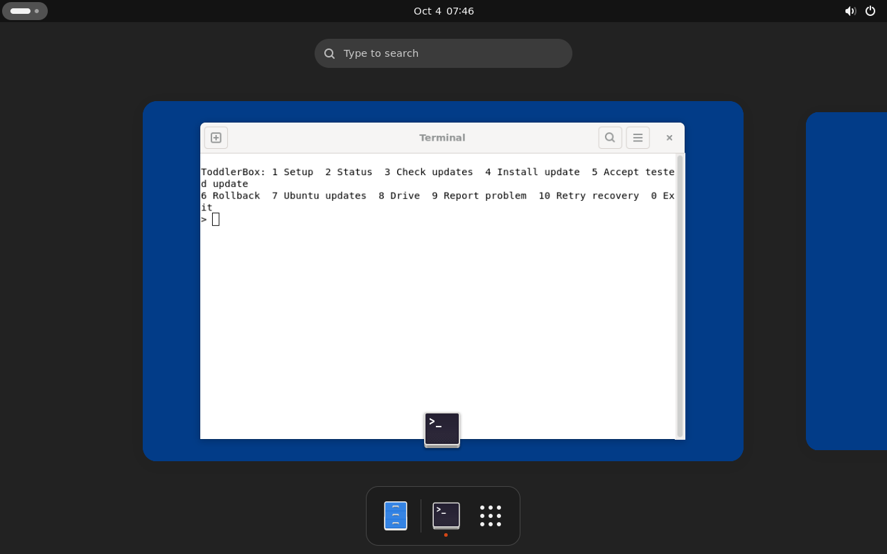

# Parent setup and maintenance



The appliance installer first asks for a parent password on its console. Then
log into **parent** on the normal Ubuntu desktop. **ToddlerBox Setup & Maintenance**
opens automatically until setup is complete, and remains in the applications menu.
There are no default passwords or Git credentials.

This is deliberately a simple terminal program. Follow its prompts; open Ubuntu
Wi-Fi or Sound settings when offered. Checks can be recorded as passed, failed
or skipped. Offline use and skipping Drive are valid. Previously recorded checks
are retained unless you explicitly redo them.

The recovery check requires a real supervised child session: let it run at least
ten seconds, try input and volume keys, then hold Ctrl+Alt+Home for two seconds.
Authenticate as parent again and finish setup. Reboot during this test returns
to unfinished parent setup. Finishing requires the successful recovery check;
other hardware limitations can be accepted explicitly.

Since 0.5.0, the optional Drive check and **Set Up ToddlerBox Drive**
find packages on mounted USB drives and verify their adjacent full checksums.
No path/hash typing is needed, and the result stays visible until dismissed.
This can be rerun after setup is complete without resetting progress or
reinstalling; see [the existing-install patch instructions](drive-sync.md#rerun-usb-setup-without-reinstalling).

The program offers:

- Since 0.5.0, an explicit **Apply louder audio defaults** choice.
  It preserves other settings and backs up the original configuration; ordinary
  updates keep custom gains. See [audio controls](child-controls.md).
- Status, including setup results, system services, disk space, update/recovery
  state, Drive's last successful completion and Ubuntu reboot requirement.
- Check/install qualified public GitHub releases, accept a tested candidate,
  rollback and retry an interrupted recovery.
- Explicit Ubuntu package updates and repair of interrupted package configuration.
- Drive setup/import/sync/status/reconnect. A chosen private setup package has its
  checksum calculated automatically and each member validated by the importer.
- A reviewed local support report and a prefilled public GitHub issue.

Save parent desktop work before installing, rolling back or retrying recovery:
session restarts can end that desktop session. Test the candidate child session,
return through parent login, and select **Accept tested update**. Until acceptance,
one previous working system/app pair remains the recovery target; another update
is refused. The candidate has at most two explicit test entries. Failed application
startup/exhausted supervision or controller failure restores that pair and opens
parent recovery. New drawings and Typing documents remain separate from releases.

Downloads require networking; ordinary local use, status and rollback do not.
Check/install uses public HTTPS without GitHub login. GitHub's `gh` CLI is included
for convenience, but its authentication is not part of the update path. Integrity
and authenticity checks are automatic; no manual release-hash comparison is needed.

Ubuntu updates use signed normal Noble repositories, including security fixes.
They are parent initiated: no unattended package installs or automatic reboots.
Check monthly and reboot when requested. These package changes are outside
ToddlerBox bundle rollback. Retain the recovery USB and back up child work.
The persistent GRUB recovery entry survives Ubuntu kernel/menu regeneration;
normal Ubuntu remains the default, with the five-second menu available at boot.
If package state is inconsistent, complete **Ubuntu updates** before installing
another bundle or returning to child mode. A network/mirror failure with verified
consistent package state leaves offline child use available. Local conffiles are
preserved and maintenance output is visible in the parent terminal.

Status/report remain available when installation recovery is blocked. A corrupt
backup is refused, rather than guessed at; try **Retry recovery** after fixing
storage problems. The boot recovery menu, independent console and USB remain
available if graphical recovery cannot start. No multi-file update promises a
whole-disk atomic transaction or reversal of Ubuntu packages.

Reports contain an allowlist of states/versions, not photos, drawings, document
text, credentials, raw logs, Wi-Fi names, serial numbers or private paths. Review
the report before choosing to post publicly. GitHub requires browser login to
submit an issue; no token is stored by ToddlerBox. Without network/account access,
keep `~/ToddlerBox-support.json` and share it later.

Drive remains explicit-only (`ctrl-alt-s`, held two seconds, or parent sync action).
Setup, updates and network connection do not trigger it. Its account-wide read
scope and private credentials are explained in [Drive privacy](drive-sync-privacy.md).
Software/public reports and private family data have separate handling.

## Parent speaker check

In the parent GNOME desktop, select **Built-in Audio / Speakers** in Sound settings
and start with the speaker volume low. The 0.5.1 app provides an explicit,
quiet, one-second synthetic tone; it needs no network or extra Python packages:

```sh
/opt/toddlerbox/current/.venv/bin/python -B -m toddlerbox.runtime.audio_check
```

Run without `sudo`, so playback uses the parent's audio session. Press Enter to
play or Ctrl+C to cancel. Playback has a five-second deadline and removes its
private temporary WAV afterward. A successful exit establishes that PipeWire
accepted playback; listening establishes speaker output. It does not establish
child-session routing, music loudness or physical touchscreen behavior. Test
Reading, Math and Music separately after returning to child mode.

Future images include `alsa-utils` (`speaker-test`, `aplay`, `alsamixer`) and
`pulseaudio-utils` (`pactl`, `paplay`) explicitly. Existing installs already have
`pw-play` and do not need those packages for this check. App updates do not install
new Ubuntu packages; adding optional diagnostic packages is a separate parent
operation when networking is available. Never run a looping full-volume test or
raise system volume automatically to diagnose a quiet speaker.

## Optional parent diagnostics in new images

The 0.5.3 image recipe includes input-event, disk-health and PCI tools. These are
explicit parent actions; no SMART daemon, timer or background test is enabled.
Older images may lack them, and app updates do not add Ubuntu packages. No new
installation/reinstall is required merely to use the updated activities.

In parent mode on a new image, `sudo toddlerbox-check-diagnostics` checks command
availability/versions and disabled SMART startup with bounded help queries. It
plays no sound and captures no input. Use the existing speaker check above for a
deliberate quiet tone; its accepted behavior has not changed.

For deeper diagnosis, first identify the intended input/disk device. Keep any raw
output in a mode-0700 private directory created with umask 077. Never publish
keyboard events, touch coordinates, media names, device identities or credentials.
Bound any input recording with a kill backstop and never use an exclusive grab.
Only inspect disk health unless a separate disk test was explicitly requested.
Read-only examples (replace placeholders after checking the exact device):

```sh
sudo timeout --kill-after=2s 5s libinput list-devices
sudo timeout --kill-after=2s 5s libinput debug-events --device /dev/input/eventX
sudo timeout --kill-after=2s 5s evtest /dev/input/eventX
sudo timeout --kill-after=2s 10s smartctl -H -A /dev/DISK
timeout --kill-after=2s 5s lspci -k
```

Virtual-device checks establish tool operation and policy, not physical touch,
SMART passthrough or human hearing. Keep parent escape usable throughout.
